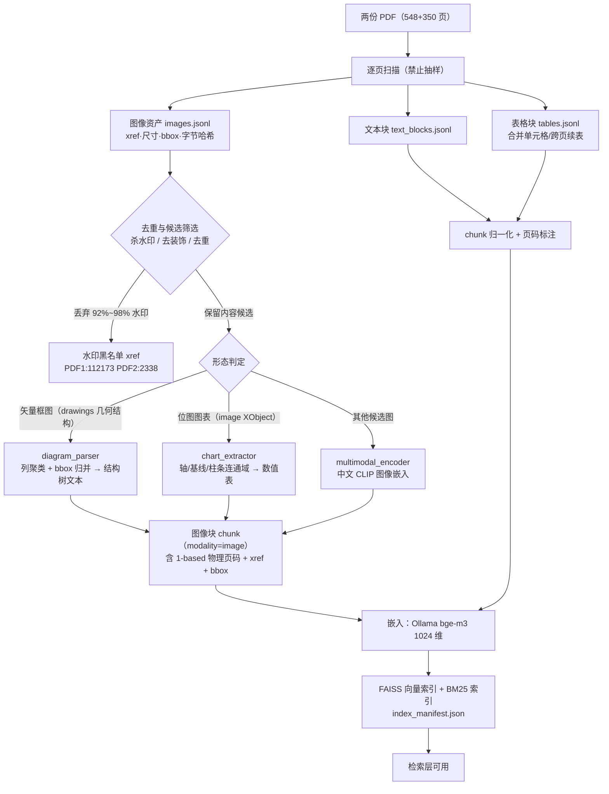
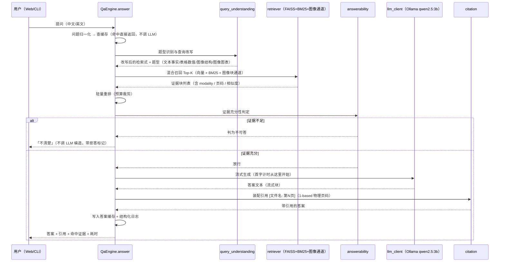

# 工单4 系统架构

> 工单编号：**人工智能NLP-RAG-图像内容解析及检索优化**
> 仓库：`E:\gao6gongdan\工单4`
> 事实基线：`设计/环境事实.md`（本文所有环境数字均引自该文实测，不另作推测）
> 工单3 关系：**只读基础**。文本/表格解析与检索生成链路沿用工单3 已验证实现（复制到工单4 后适配），
> 本工单的**增量**是「图像内容解析 → 可检索图像块 → 与文本证据融合作答」。

---

## 1. 架构总览

```
┌──────────────────────────────────────────────────────────────────────────────────┐
│                         交互层（中文 Web / CLI）                                  │
│  CLI: 研发/app/main.py --ask "..."        HTTP: 部署/脚本/serve_api.py (FastAPI)  │
│  Web: 研发/app/ui/serve_fallback.py(纯标准库) / streamlit_app.py(真 Streamlit)    │
│  三者共用同一 app/core 业务逻辑（禁止各写一套）                                     │
└───────────────────────────────┬──────────────────────────────────────────────────┘
                                │ 统一问答入口 QaEngine.answer(question, ...)
┌───────────────────────────────▼──────────────────────────────────────────────────┐
│                        问答层 app/core/qa_engine.py                               │
│  查询理解 → 混合检索 → 重排 → 可答性判定 → 生成 → 引用装配 → 缓存                  │
│  ├─ query_understanding.py   问题归一化 / 改写 / 题型识别（文本事实·表格数值·图像结构·图像图表）
│  ├─ retriever.py             FAISS 向量 + BM25 混合召回（RRF 融合）+ 图像块通道
│  ├─ reranker.py              轻量重排（预算受控）
│  ├─ answerability.py         证据充分性门槛 → 不足则「不清楚」（拒答红线）
│  ├─ generator.py             提示词组装 + 引用约束 + 答案后处理
│  ├─ citation.py              引用装配：一律 [文件名: 第N页]，N = 1-based 物理页码
│  ├─ llm_client.py            可插拔后端 ollama / openai(兼容 vLLM·SGLang) / extractive 兜底
│  └─ cache.py                 问题归一化缓存 + 检索缓存 + 答案缓存（可落 SQLite）
└───────────────────────────────┬──────────────────────────────────────────────────┘
                                │ 同一份索引契约（chunk 带 modality 字段）
┌───────────────────────────────▼──────────────────────────────────────────────────┐
│                        索引层 app/core/vector_store.py + bm25_index.py             │
│  向量库：FAISS（主用，faiss 1.7.4 已装）；embedder：Ollama bge-m3:latest（1024 维） │
│  Milvus 适配器：milvus_store.py（接口就位，非运行必需，不得成为启动依赖）            │
│  索引产物：研发/data/index/{vectors.npy, ids.json, bm25.pkl, index_manifest.json}  │
│  统一 chunk 契约（文本块 / 表格块 / 图像块共用，见 §5.2）                           │
└───────────────────────────────┬──────────────────────────────────────────────────┘
                                │
┌───────────────────────────────▼──────────────────────────────────────────────────┐
│                      解析层（工单4 核心增量）                                      │
│                                                                                   │
│  文本/表格（复用工单3）           图像内容（本工单新增）                            │
│  ├─ pdf_parser.py                 ├─ image_parser.py     图像资产提取·去重·候选筛选 │
│  ├─ table_parser.py               ├─ diagram_parser.py   矢量框图结构树解析          │
│  │   · 合并单元格 None 填充       ├─ chart_extractor.py  位图图表像素级数值抽取      │
│  │   · 格内换行归一化             └─ multimodal_encoder.py CLIP 语义编码(中文CLIP)  │
│  └─ chunker.py                                                            │
│      · 跨页续表检测 + 表头继承                                            │
└───────────────────────────────┬──────────────────────────────────────────────────┘
                                │
┌───────────────────────────────▼──────────────────────────────────────────────────┐
│                    语料与外部服务（只读 / 外部进程）                               │
│  PDF：研发/data/raw/招股说明书1.pdf(548页) · 招股说明书2.pdf(350页)                │
│  Ollama 127.0.0.1:11434：bge-m3:latest(嵌入 1024) · qwen2.5:3b(生成)              │
│  CLIP 权重：研发/data/models/chinese-clip-vit-base-patch16（OFA-Sys 中文 CLIP，771,304,190 B）│
│  GPU：RTX 2060 6GB（经备用解释器 工单1\.gao6gongdan-src\python.exe torch cu124）    │
└──────────────────────────────────────────────────────────────────────────────────┘
```

**一句话架构**：把「一份文档」拆成三种模态的证据块（文本 / 表格 / **图像**），
用同一套索引与检索通道召回，再由带引用约束的生成器合成答案——图像块与文本块**同等地位**，不是附件。

---

## 2. 为什么需要图像解析（本工单的存在意义）

工单3 已把「文本 + 表格」做到 14/14。工单4 新增的两题（第 5、6 题）**答案不在文本层里**：

| 题 | 载体 | 为什么文本 RAG 答不出 |
| --- | --- | --- |
| 第 5 题 | PDF2 物理页 39 组织结构图 | 节点名是**竖排文字、每字一个 span**，`get_text()` 直接给出的是 324 字符的字符流；层级关系只存在于**几何坐标**里 |
| 第 6 题 | PDF2 物理页 72 两张位图 | 7 组「行业—增长率」数值**只存在于像素里**，文本层只有标题与一句正文 |

→ 因此架构必须提供两条**独立于文本层**的证据生成通道：**几何结构解析**与**像素数值抽取**，
再用 CLIP 语义嵌入把它们接入检索，最后用正文（页 40 / 113 / 页 72 正文）做**交叉印证**。

---

## 3. 解析链路（Mermaid）



**关键约束（来自实测）**

1. **去重是第一道闸**：PDF1 的 8427 张图里 `xref=112173` 出现 8248 次（97.9%）；PDF2 的 5701 张里 `xref=2338` 出现 5250 次（92.1%）。**两者都是「八维教育」水印**，必须先剔除。
2. **「有 drawings」不等于有框图**：两份 PDF **全部 898 页**都有矢量绘图元素（PDF1 共 67,652 个），故框图识别必须靠**几何结构判定**（矩形框数量、包含关系、层级深度），不能靠「有 drawing 就算」。
3. **1-based 物理页码贯穿全链路**：解析层产出页码 → chunk 携带 → 引用装配 → 测试断言，任一环换口径都会整篇错位（见 `设计/环境事实.md` §7）。

---

## 4. 问答链路（Mermaid 时序）



---

## 5. 数据与接口契约

### 5.1 目录职责（五文件夹）

| 文件夹 | 职责 | 主要产出 |
| --- | --- | --- |
| `设计/` | 环境事实、架构、图像解析方案、接口、验收标准 | 本目录 6 份文档 + `复现脚本/` |
| `研发/` | 可运行代码、解析产物、索引、评估集 | `app/core`、`app/ui`、`scripts`、`data/{raw,processed,index,eval,models}` |
| `测试/` | 三级测试（离线/在线/用户）+ 逐题截图留痕 | `测试报告.md`、`测试截图/`、`测试数据/` |
| `优化/` | 缓存/批处理等可量化优化与前后对比 | `优化报告.md`、`基线/`、`评估结果/` |
| `部署/` | 打包、启动脚本、Docker、交付物核验、README | `README.md`、`脚本/`、`docker/`、`交付物核验.md` |

### 5.2 统一 chunk 契约（文本块 / 表格块 / 图像块共用）

```json
{
  "chunk_id": "pdf2-p39-img-1693-0",
  "modality": "image",
  "modality_sub": "diagram | chart | picture",
  "corpus": "招股说明书2.pdf",
  "page": 39,
  "page_basis": "1-based-physical",
  "xref": 1693,
  "bbox": [89.9, 367.2, 318.2, 538.6],
  "text": "（供嵌入与检索的可读文本）组织结构图：销售部下设 4 个部门……",
  "structured": {"tree": {"name": "销售部", "children": ["电话及网络销售部", "渠道销售部", "大客户销售部", "国际贸易部"]}},
  "image_sha1": "…",
  "embed_model": "bge-m3:latest",
  "embed_dim": 1024,
  "clip_embed_ref": "images_clip.npy#idx=42"
}
```

**硬性要求**：`modality` 必填；`page` 必须是 **1-based 物理页码**；图像块必须带 `xref`+`bbox` 才能被引用回溯。

### 5.3 模块 ↔ 文件 ↔ 责任人对齐

| 能力 | 文件 | 主责 |
| --- | --- | --- |
| 图像资产提取与去重 | `研发/app/core/image_parser.py` | 图像工程师 |
| 矢量框图结构树 | `研发/app/core/diagram_parser.py` | 图像工程师 |
| 位图图表数值抽取 | `研发/app/core/chart_extractor.py` | 图像工程师 |
| CLIP 语义编码 | `研发/app/core/multimodal_encoder.py` | 图像工程师 |
| 文本/表格解析、索引 | `研发/app/core/{pdf_parser,table_parser,chunker,vector_store,bm25_index,embedder}.py` | 文档解析工程师 |
| 检索与生成 | `研发/app/core/{retriever,reranker,qa_engine,generator,citation,answerability,llm_client}.py` | 检索生成工程师 |
| Web / CLI | `研发/app/ui/**`、`研发/app/main.py` | 检索生成工程师 |
| 评测与截图 | `测试/**` | 测试工程师 |
| 缓存与优化 | `优化/**`、`研发/app/core/cache.py` | 检索生成工程师 |
| 打包与核验 | `部署/**`、`README.md` | 部署工程师 |

---

## 6. 性能设计：3 秒预算是怎么花的

实测基线（`设计/环境事实.md` §5）：`qwen2.5:3b` **预热后**首字 **23.5~25.2 ms**、总耗时 216~217 ms；
**冷启动首字 3430.8 ms** —— 冷启动口径必违约，故：

| 预算项 | 设计目标 | 手段 |
| --- | --- | --- |
| 启动预热 | 不计入单次问答 | 服务启动时预热 LLM + 嵌入 + 索引（惰性加载 + 预加载向量矩阵） |
| 问题归一化缓存 | 命中即 ~0 ms | 归一化（去空白/标点/同义）→ SQLite 键值缓存 |
| 检索 | ≤ 300 ms | FAISS 内积 + BM25 并行；Top-K 受控；图像块通道**只在小候选集上算 CLIP 相似度** |
| 重排 | ≤ 200 ms | 轻量规则/交叉特征；预算超限即跳过并记日志（显式降级） |
| 生成 | ≤ 1800 ms | `qwen2.5:3b` 流式；`num_predict` 受控；**流式首字即计时终点口径之一** |
| 引用装配 | ≤ 50 ms | 纯字符串/模板，不调模型 |
| **端到端** | **≤ 3000 ms（P95）** | 上表之和 + 余量；**必须实测 P50/P95/最大** |

**口径纪律（工单3 的血泪）**：延迟测量必须 **预热 + 独占 Ollama**；
并发加压下工单3 实测首字飙到 10.8 s，**并发口径不得用于验收**。

---

## 7. 降级矩阵（禁止静默失败）

| 故障 | 检测方式 | 显式降级路径 | 留痕要求 |
| --- | --- | --- | --- |
| Ollama 不可达 | 启动探测（≤0.5 s，不重试） | → `extractive` 后端（抽句作答，仍带引用） | 日志记 `backend=extractive` + 原因；报告中标注 |
| 生成超时 | 生成侧超时 | → 返回检索到的证据摘要 + 引用，并标注「生成降级」 | 同上 |
| CLIP 权重缺失 | 加载时异常捕获 | → 图像块退化为「结构树文本 + 数值表」参与检索（图像语义通道关闭） | 报告中写明 CLIP **未运行**及原因，**严禁伪造相似度** |
| GPU 显存不足 | `torch.cuda.OutOfMemoryError` | → 回退 CPU 编码（记录耗时差异） | 日志 + 报告标注实际设备 |
| FAISS 不可用 | import/加载异常 | → numpy 精确内积检索 | 报告标注实际检索后端 |
| 表格 `find_tables()` 返回空 | 逐页统计 | → 该页仅产出文本块 | 解析报告中登记该页清单 |
| 证据不足 | answerability 门槛 | → 统一回「不清楚」 | 记 `refused=true` 与门槛值 |

**红线**：任何降级都必须**同时**满足「功能可用」与「留痕如实」；不得把降级结果当作正常结果上报。

---

## 8. 关键设计决策与理由（ADR 摘要）

| # | 决策 | 理由（实测依据） |
| --- | --- | --- |
| D1 | **不装 cv2/pandas 等缺失依赖**，用 numpy+PIL+标准库实现 | 主解释器 pip 落点在工单1（红线）；pip 联网会挂死 |
| D2 | **CLIP 走 `transformers.ChineseCLIPModel`**，不用 `clip`/`open_clip` 包 | 两个包都缺失；`transformers` 4.57.6/5.16.1 **内置** ChineseCLIPModel（实测 True）；权重经 hf-mirror 可达（753 MB） |
| D3 | **图像编码优先用备用解释器（3.10 + torch cu124）上 GPU** | 主解释器 `torch 2.11.0+cpu`、`cuda.is_available()=False`；备用解释器实测 CUDA True、RTX 2060 |
| D4 | **Ollama 内无视觉模型，故图像理解不依赖 Ollama** | `/api/tags` 13 个模型实测无视觉模型 |
| D5 | **框图解析用几何列聚类，不用 OCR** | 页 39 文本层完整，OCR 依赖全缺且无必要；列聚类实测复原 28/29 节点 |
| D6 | **水印按 xref 黑名单剔除** | 水印占 PDF1 图片 97.9%、PDF2 92.1% |
| D7 | **FAISS 主用、Milvus 只留适配器** | faiss 1.7.4 已装；Milvus 需 Docker 提权，**不得成为启动依赖** |
| D8 | **引用只认 1-based 物理页码** | 两份 PDF 印刷页码均 = 物理 − 1（实测 17/17 成立），极易混淆 |
| D9 | **Web 双实现共用 core** | streamlit 在主解释器缺失；`serve_fallback.py` 保证本机可演示，真 Streamlit 界面在备用解释器可跑 |

---

## 9. 与工单3 的边界（避免重复劳动与冲突）

| 项 | 处置 |
| --- | --- |
| 工单3 `app/core` 文本/表格/检索/生成模块 | **复制到工单4 后适配**（工单3 保持只读） |
| 工单3 已建索引（`data/index/bge-m3_1024/`） | 可复用为初始向量；**新增图像块必须增量嵌入**，是否全量重建需先测耗时再决定 |
| 工单3 golden（14 题） | 作为 16 题 golden 的**基础真值**，但**每题的证据页必须打开 PDF 重新复核**后才冻结 |
| 工单3 的准确率/延迟数字 | **不得直接用作工单4 指标**（语料/题型已变：新增 2 道图像题） |

---

## 10. 验收锚点（详见 `设计/验收标准.md`）

1. 16 题端到端答对 **≥ 15/16（≥90%）**，其中第 5、6 题必须**由图像解析链路自动解出**（不得硬编码答案）。
2. 单次问答 **≤ 3 s**（预热 + 独占，给出 P50/P95/最大）。
3. 中文 **Web + CLI** 均可用；答案带 `[文件名: 第N页]` 引用且可回溯。
4. 无依据问题回「不清楚」；**不得编造**。
5. `测试/测试截图/` 逐题截图留痕 + `测试/测试报告.md` + 顶层 `README.md`。
