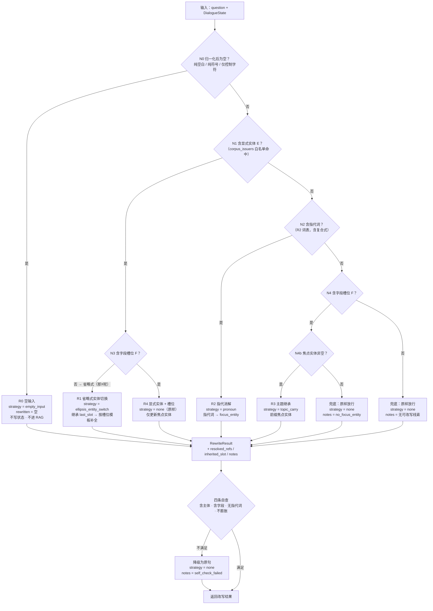

# 工单5 Query 改写流程（指代消解 · 上下文继承 · 查询重写）

> 工单编号：**人工智能NLP-RAG-Query 理解优化**
> 唯一真源：`设计/接口契约_冻结.md` §1.2（`QueryRewriter` / `RewriteResult` / `STRATEGIES` / R0~R4 规则表）。
> 上位文档：`设计/多轮对话架构.md`（分层、状态字段、焦点实体机制、降级矩阵）。
> 数字纪律：本文只写**规则与判据**，不写任何未实测的性能/准确率数字；实测见 `测试/测试报告.md`。

---

## 0. 范围

本文定义「用户原句 + 对话状态 → 独立可检索问句」这一**纯函数**的全部规则：

```text
rewrite(question, DialogueState) -> RewriteResult
```

* 输入：用户原句（逐字，未归一化）、当前 `DialogueState`（`focus_entity` / `last_slot` / `last_query` / `entity_stack` / `turns`）。
* 输出：`RewriteResult`（契约字段，见 §1）。
* **纯函数**：不访问网络、不调用模型、不读时钟、不写状态（状态由 `MultiTurnEngine` 在拿到答案后回写）。
  因此改写器**可以完全离线单测**（`测试/离线`），不需要 Ollama。
* 不做的事：不生成答案、不做语料裁决（交给工单4 的 `match_corpus`）、不做语义真伪校验（交给可答性闸门）。

---

## 1. 输出契约（`RewriteResult`，逐字段）

| 字段 | 类型 | 语义 | 判分用途 |
| --- | --- | --- | --- |
| `original` | `str` | 用户原句（逐字保留，含标点与空白） | 留痕；`changed` 的比对基准 |
| `rewritten` | `str` | 送进 RAG 的独立问句 | **指代消解专项验收的比对对象**（归一化后逐字相等） |
| `strategy` | `str` | `STRATEGIES` 七值之一 | **规则命中判定**：不是靠人眼看句子，而是断言枚举值 |
| `changed` | `bool` | `rewritten != original` | 短路与统计（`changed=false` 占多数的轮次不该出现状态漂移） |
| `focus_entity_before` | `str \| None` | 改写前焦点 | 状态演进断言 |
| `focus_entity_after` | `str \| None` | 改写后焦点（见 `设计/多轮对话架构.md` §5.2 的 U1~U8） | 状态演进断言 |
| `inherited_slot` | `str \| None` | 从上一轮继承的槽位（只在 `ellipsis_entity_switch` 与「指代+省略」子形态里非空）。**表示可以是字段名或槽位骨架**，见 §5.6 | Q4 的核心判据（判据取两者之交：非空且含「法定代表人」） |
| `resolved_refs` | `list[dict]` | `[{"surface": "他", "replacement": "武汉力源…", "kind": "pronoun"}]` | 指代面与替换目标的逐条断言 |
| `notes` | `str` | 降级/异常说明（**自由文本，不参与判分**，只用于排障） | 边界用例的可解释性 |
| `slot` | `str \| None` | **实现新增字段（契约未列，属增量）**：本轮问句抽出的槽位（骨架表示，见 §5.6） | 仅排障留痕；对外契约字段全集仍以 §1 上表为准 |

**`STRATEGIES`（契约冻结，不得新增、不得改名）**

| 值 | 本设计是否产出 | 触发 |
| --- | --- | --- |
| `none` | ✅ | R4 原样；以及全部兜底（D6/D7 等降级，原因写 `notes`） |
| `empty_input` | ✅ | R0 空/纯空白/纯符号 |
| `pronoun` | ✅ | R2 指代消解（含「指代 + 省略」子形态） |
| `ellipsis_entity_switch` | ✅ | R1 省略式实体切换（「那X呢？」） |
| `topic_carry` | ✅ | R3 只给槽位不给主体 |
| `ellipsis_topic_carry` | ⛔ **预留，默认不产出** | 契约预留值；语义为「省略式且不换实体」（如「那它的呢？」）。启用需先在本文登记触发条件与用例，**当前未启用** |
| `multi_turn_enrich` | ⛔ **预留，默认不产出** | 契约预留值；语义为「多轮扩写式增强」。启用前必须先证明不改写也能答的方案不可行，并补用例 |

> **枚举封闭性（不变量 I2）**：实现里任何分支都只能落在上表 7 个值内。降级不得引入新词，一律用 `none` + `notes` 表达。

---

## 2. 主流程图（R0~R4，顺序敏感）



**流程要点**

1. **N1 先于 N2**：显式实体优先级高于指代。因此「那武汉力源信息技术股份有限公司呢？」走 `N1→N3(否)→R1`，**不会**被当成指代处理。
2. **N3 同时决定 R1 与 R4**：有实体时「有没有槽位」是唯一分叉（无槽位=省略式 → R1；有槽位=完整问句 → R4）。
3. **R2 只在「无显式实体」时成立**：指代 + 显式实体同现的句子（如「那力源呢，他的法定代表人是谁？」）走 R4（显式实体为准），
   句内指代**不做替换**（避免与「显式实体优先」冲突），并在 `notes` 记 `pronoun_with_entity`——此时句子已含主体，检索不受影响。
4. **R3 加了一道前置门（N4b）**：契约 R3 的动作是「前缀焦点实体」，焦点为空时**没有可前缀的东西** →
   降级为 `none`，把「无主体」这一事实交回工单4 的可答性闸门去拒答（多轮层**绝不猜测**主体）。
5. **出口自查（SELF）**：任何分支产出都要过 `设计/多轮对话架构.md` §4.4 的四条自查；不过就退回原句（宁可少改写，不可改坏）。

---

## 3. 规则判定表（顺序敏感，命中即停）

| # | 前置（全部满足） | 动作 | `strategy` | 是否写状态 |
| --- | --- | --- | --- | --- |
| **R0** | 归一化后为空（`strip()` 后长度为 0，或去掉全部标点/空白/控制字符后长度为 0） | `rewritten=""`；`changed=false`（R0 是「拒绝」，不是「改写」，见不变量 I3 的例外） | `empty_input` | ❌ 不写（`设计/多轮对话架构.md` §5.2 U6） |
| **R1** | 含**白名单**显式实体 E **且** 无槽位 | `inherited_slot = last_slot`；按槽位模板生成 `{E}的{F}<问式>` | `ellipsis_entity_switch` | ✅ 焦点 → E（入栈/置顶） |
| **R2** | 无白名单实体 **且** 命中指代词 | 指代面 → `focus_entity`（最长复合面优先）；`resolved_refs` 逐条留痕 | `pronoun` | ✅ 焦点**不变** |
| **R3** | 无实体 **且** 无指代词 **且** 有槽位 **且** 焦点非空 | 以焦点实体为前缀补全主体 | `topic_carry` | ✅ 焦点**不变** |
| **R4** | 含白名单实体 **且** 有槽位 | 原样返回（`changed=false`） | `none` | ✅ 焦点 → E（入栈/置顶，即 U1/U2/U5） |
| 兜底 | 以上都不成立（无实体、无指代、无槽位，或前置门不满足） | 原样返回 + `notes` 说明 | `none` | 仅当含白名单实体时才更新焦点（本分支通常为否） |

### 3.1 判定伪代码（设计表达，非实现代码）

```text
归一化 blank ← 去掉标点/空白/控制字符后是否为空
实体 E      ← detect_entities(question)            # 白名单口径，最长优先
槽位 F      ← detect_slot(question)                # 见 §5
指代面 refs ← 指代匹配(question)                    # 见 §4，最长复合面优先

若 blank:                                    → R0
若 E 且 F:                                   → R4（原样）
若 E 且 非 F:                                → R1（继承 last_slot，按模板补全）
若 非 E 且 refs 非空:
        若 focus_entity 为空:                → 兜底 none（notes=no_focus_entity）
        否则: 逐条替换 refs → 若替换后仍为省略式（…呢）→ 叠加 R1 模板（inherited_slot=last_slot） → R2
若 非 E 且 refs 为空 且 F:
        若 focus_entity 非空:                → R3（前缀焦点实体）
        否则:                                → 兜底 none（notes=no_focus_entity）
否则:                                        → 兜底 none（notes=无可改写线索）
最后: 四条自查（含主体/含字段/无指代词/不膨胀）不过 → 退回原句，strategy=none
```

---

## 4. 指代与省略的识别规则

### 4.1 指代词表（R2 词表 = 契约词表）

| 指代词 | 类别 | 触发 R2 | 替换目标 | 误触发护栏（必须实现） |
| --- | --- | --- | --- | --- |
| 他 / 她 / 它 | 人称代词 | ✅ | `focus_entity` | 语料主体是**法人**：统一解析为焦点实体，**不做**性别/生命度推断（Q2 的「他」= 公司）；`focus_entity` 为空则不替换 |
| 其 | 篇章代词 | ✅（条件式） | `focus_entity` | 「其中 / 其他 / 其余 / 其它 / 尤其 / 与其」为**否定词表**，整体匹配时**不触发**；「其」后紧接主体名词（其公司/其股东/其产品）时才作为指代面 |
| 该 | 指示代词 | ✅（条件式） | `focus_entity` | 仅「该 + 主体名词」形态触发（该公司/该企业/该标准/该工程/该部门）；「应该 / 该当 / 该指标」不触发 |
| 这个 / 那个 | 指示代词 | ✅ | `focus_entity` | 「那个」用于比较句（「哪个…那个…」）时按「疑问词优先」不触发；单字「那」**不在** R2 词表内（属省略式提示词，见 §4.2） |
| 上述 / 前述 | 篇章代词 | ✅ | `focus_entity` | 无额外护栏（本身就是强指代） |
| 该公司 / 这家 / 此项 / 本公司 | 固定指代式 | ✅ | `focus_entity` | 「**本公司**」在问句里常是**用户自指**（用户所在单位）而非语料主体 → 仅在焦点非空时替换，并记 `notes=ambiguous_self_reference` |
| 这个公司 / 这家公司 / 该企业 / 上述公司 / 该部门 / 该项工程 / 该标准 | 复合指代式（**指代词 + 主体名词**） | ✅ | `focus_entity` | **最长匹配优先**：必须先尝试复合式（≤6 字）再退到单指代词。否则「这个公司的法定代表人」会被替换成「…公司公司的法定代表人」（病句护栏） |
| 这里 / 这样 / 这么 / 这时 | 方式/处所/时间指代 | ❌ **不触发** | — | 显式列入不触发清单，防止把「这样处理」误换成公司名 |

**替换范围规则**

1. **只替换指代面本身**，问句其余字符**逐字保留**（含标点、空格、语气词）。
2. **最长复合面优先**，同一位置只替换一次（避免重复替换造成膨胀）。
3. 一次可命中**多处**指代（如「他的公司里，这个部门…」）：全部替换，`resolved_refs` 逐条记录。
4. **英文化**：英文问句使用并列词表 `he / she / it / they / this company / that company / the company / the above-mentioned`，
   语义与中文一致；英文路径的槽位词表见 §5.5（**降级路径，不保证与中文同精度**）。

### 4.2 省略式识别（「那X呢？」「X呢？」）

**形态**（描述性正则，实现时用等价的 `re` 表达，**不使用**任何 NLP 模型）：

```text
省略式1（带提示词）：^\s*(?:那|那么|嗯|还有|另外)?\s*(?P<E>.{2,40}?)\s*(?:呢|如何|怎么样|怎样|咧)\s*[？?]?\s*$
省略式2（裸实体）：  ^\s*(?P<E>.{2,40}?)\s*[？?]?\s*$        # 仅当 E 命中白名单且无槽位时才成立
```

**三个条件必须同时成立**（否则**不**判为省略式）：

| # | 条件 | 反面例子 | 判定 |
| --- | --- | --- | --- |
| C1 | 句末是省略语气词（`呢/如何/怎么样/怎样/咧`）或整句只有实体 | 「武汉力源…呢？」✅ | 「武汉力源…组织结构图里哪个销售处最多？」❌（真问句，走 R4） |
| C2 | **去掉实体与提示词后没有实义残留**（无槽位词、无 ≥2 个实词） | 「那武汉力源信息技术股份有限公司呢？」✅ | 「那武汉力源的法定代表人呢？」❌（有槽位 → 走 R1/R4 之外的常规分支） |
| C3 | 抽出的 `E` 命中 `corpus_issuers` 白名单 | 「那武汉力源…呢？」✅ | 「那明天呢？」❌（白名单外 → 兜底 `none`） |

**补全动作**（R1）：`inherited_slot = last_slot`，用 §5.4 的模板族生成独立问句；
`last_slot` 为空 → 兜底 `none` + `notes=no_slot_to_inherit`（**焦点仍按 U1 更新**，因为实体切换是显式意图）。

**「指代 + 省略」子形态**（如「他呢？」）：按 R2 替换指代面后，句子变成「武汉兴图新科电子股份有限公司呢？」——
仍是省略式 → **叠加** R1 的模板补全（`inherited_slot=last_slot`），`strategy` 仍为 `pronoun`（不新增枚举值），
`notes=pronoun_plus_slot_inherit`。

### 4.3 病句护栏（改写质量的三条硬规则）

| # | 规则 | 反例 |
| --- | --- | --- |
| 1 | 替换后**不得**出现「公司公司 / 有限公司有限公司」类重复 | 「这个公司」只替换「这个公司」，不替换「这个」 |
| 2 | 替换后**不得**残留任何 R2 词表命中 | 命中即视为自查失败 → 退回原句 |
| 3 | 替换后长度 ≤ 原句长度 + `len(实体全称) × 命中次数 + 12`（模板开销） | 超出 → 退回原句，`notes=self_check_failed` |

---

## 5. 字段槽位（slot）抽取规则

### 5.1 什么是「槽位」

槽位 = **用户问的是哪个字段** 的归一化名（`法定代表人` / `注册资本` / `军用领域收入` / `组织结构图-销售部-销售处` …）。
它是 Q4 能成功的关键：用户说「那X呢？」时，唯一能补回「问什么」的信息就是**上一轮的槽位**。

### 5.2 词表来源（**不新建平行词表**）

* **主词表**：复用 `研发/app/core/query_understanding.py::FIELD_TERMS`（已存在，含
  `注册资本 / 法定代表人 / 发行股数 / 发行后总股本 / 募集资金 / 补充流动资金 / 关联方 / 控股股东 / 实际控制人 /
  持股比例 / 军用领域 / 主营业务收入 / 技术标准 / 组织结构图 / 上游 / 下游 / 供应商 / 科技进步一等奖 / 增长率 /
  报告期 / 应用结构`）。
* **改写器内的槽位归一表**：把「词表命中项 + 问式」映射到标准 slot 名与问式类别（§5.4）。
  该映射是**改写器的私有数据**，不改 `FIELD_TERMS`，也不与它并行维护同义清单（避免两套词表漂移）。
* **术语兜底**：词表未覆盖时用「问式模板」推断槽位（§5.3 第 2 级），仍失败则 `slot=None`。

### 5.3 三级抽取（顺序敏感，命中即停）

| 级 | 规则 | 例子 |
| --- | --- | --- |
| 1 | **词表最长匹配**（在问句中去修饰后匹配 `FIELD_TERMS`） | 「这个公司的**法定代表人**是谁？」→ `法定代表人`；「报告期内…来自**军用领域**的收入分别是多少？」→ `军用领域收入` |
| 2 | **问式模板归一**（问句含 `是谁/是多少/有哪些/分别是多少/占比是多少` 之一，且问句有明确的被问对象） | 「…**技术标准**？」→ `技术标准`；「…**销售处最多**？有哪些销售处？」→ `组织结构图-销售部-销售处` |
| 3 | 兜底 | `slot=None`（不猜测） |

### 5.4 槽位 → 问式模板族（R1/R3 补全时使用）

| 问式类别 | 典型槽位 | 模板 | 出处 |
| --- | --- | --- | --- |
| 人称类 | 法定代表人 / 控股股东 / 实际控制人 / 关联方 | `{E}的{F}是谁？` | Q4 的期望产物（本工单需求原文逐字给出「…的法定代表人是谁？」） |
| 数值类 | 注册资本 / 发行股数 / 军用领域收入 / 补充流动资金 | `{E}的{F}是多少？` | 工单4 16 题同类问式 |
| 序列类 | …分别是多少 / …的比重分别是多少 | `{E}的{F}分别是多少？` | 同上 |
| 枚举类 | …有哪些 / 组织结构图销售处 | `{E}的{F}有哪些？` | 同上 |
| **默认（契约原式）** | 未命中以上类别 | `{E}的{F}是什么？` | `设计/接口契约_冻结.md` §1.2 R1 |

> 模板族是对契约默认式的**细化**（默认项仍是契约原式），不改变 `strategy` 取值，不新增枚举值。

### 5.5 槽位的两个边界

* **多槽位同现**（「注册资本和法定代表人分别是什么？」）→ 取**位置最后**的槽位作为 `last_slot`（就近原则），`notes=multi_slot`；
  改写不拆句（拆句会改变答案形态，属越权）。
* **英文槽位词表**（`legal representative / registered capital / issuing shares / military revenue / technology standard /
  organizational chart / upstream / downstream / supplier …`）→ 与中文槽位名一一对应；
  英文省略式模板**不支持**（`what about X?` → `notes=ellipsis_en_unsupported`，原样放行）。
  英文路径整体标为**降级路径**，精度不保证，须在测试报告中如实登记。

### 5.6 槽位的两种表示（**契约注释与实现的差异登记**）

| 表示 | 形态 | 来源 | 还原补全的能力 |
| --- | --- | --- | --- |
| **字段名表示** | `法定代表人` / `军用领域收入` | `设计/接口契约_冻结.md` §1.1 的 `last_slot` 注释示例（「如 `"法定代表人"`」） | 靠 §5.4 的模板族拼出 `{E}的{F}<问式>` |
| **槽位骨架表示**（落地实现采用） | `法定代表人是谁？`（把实体、指代词、省略语气词挖掉后的**问句骨架**） | `研发/app/core/dialogue_state.py` 的 `last_slot` 说明与 `研发/app/core/query_rewriter.py` 的 `slot_template()` | 直接 `{E} + 的 + 骨架`，**天然保留原问式**（因此 Q4 得到「…的法定代表人是谁？」而不是契约默认的「…是什么？」） |

**纪律**

1. 两种表示都满足契约「上一轮问的**字段槽位**」的语义，且都唯一决定了补全模板，因此**都合规**；
2. **但差异必须显式登记**（登记在 `设计/接口契约_冻结.md` 或 `测试/测试报告.md`），不得让读者从行为反推；
3. **验收判据取两者之交**：`inherited_slot` / `last_slot` **非空且包含「法定代表人」**（`设计/验收标准.md` §3.4），
   而**不**断言等于某一种表示的完整串——避免用表示细节去误判一个功能正确的实现；
4. 无论哪种表示，**硬判据始终是 `rewritten` 逐字相等**（§6.6）。

---

## 6. 五个用例的逐轮改写推导（本文重点）

> 会话：`session_id="s1"`，初始状态 `focus_entity=None`、`last_slot=None`、`entity_stack=[]`、`turns=[]`。
> 语料白名单（`corpus_issuers`，由索引自动统计，**代码内不硬编码**）：
> `pdf1 → 武汉兴图新科电子股份有限公司`，`pdf2 → 武汉力源信息技术股份有限公司`。

### 6.1 Q1 —— 显式实体 + 槽位（R4，原样）

| 项 | 值 |
| --- | --- |
| 原句 | 报告期内，武汉兴图新科电子股份有限公司来自军用领域的收入分别是多少？ |
| 命中规则 | **R4**（含白名单实体 + 含槽位；不含指代词） |
| `strategy` | `none` |
| 焦点实体 | `None` → `武汉兴图新科电子股份有限公司`（压栈） |
| 继承槽位 | 无（本轮**新抽**槽位 `军用领域收入`，写入 `last_slot` 供后续轮继承） |
| `resolved_refs` | `[]` |
| 改写后问句 | **与原句逐字相同**（`changed=false`）→ 与工单4 单轮路径等价，语料路由 `corpus_hint=pdf1` 生效 |

### 6.2 Q2 —— 人称指代（R2，`pronoun`）

| 项 | 值 |
| --- | --- |
| 原句 | 他参与的哪个工程荣获了国家科技进步一等奖？ |
| 命中规则 | **R2**（无显式实体；指代面「他」命中 R2 词表） |
| `strategy` | `pronoun` |
| 焦点实体 | 武汉兴图新科电子股份有限公司 → **不变**（保持轮，U3） |
| 继承槽位 | 无 |
| `resolved_refs` | `[{"surface": "他", "replacement": "武汉兴图新科电子股份有限公司", "kind": "pronoun"}]` |
| 改写后问句 | **武汉兴图新科电子股份有限公司参与的哪个工程荣获了国家科技进步一等奖？** |
| 关键点 | 「他」**不在**工单4 `conversation.py::_ANAPHORA` 词表内 → 工单4 路径**不会消解**；本设计把「他/她/它」纳入 R2 词表并把目标定义为**法人焦点实体**（不做性别推断） |
| 状态副作用 | `last_slot = 国家科技进步一等奖工程`（写入，供后续省略式继承） |

### 6.3 Q3 —— 复合指代（R2，`pronoun`）

| 项 | 值 |
| --- | --- |
| 原句 | 这个公司的法定代表人是谁？ |
| 命中规则 | **R2**（无显式实体；复合指代面「这个公司」命中） |
| `strategy` | `pronoun` |
| 焦点实体 | 武汉兴图新科电子股份有限公司 → **不变** |
| 继承槽位 | 无（本轮新抽 `法定代表人`） |
| `resolved_refs` | `[{"surface": "这个公司", "replacement": "武汉兴图新科电子股份有限公司", "kind": "pronoun"}]` |
| 改写后问句 | **武汉兴图新科电子股份有限公司的法定代表人是谁？** |
| 关键点 | ① 必须按**最长复合面**匹配「这个公司」，否则会产出「…公司公司的法定代表人是谁？」；② 改写后问句含公司全称 → 工单4 的 `match_corpus` 才能给出 `corpus_hint=pdf1`，把检索约束到 `招股说明书1.pdf`（这正是工单4 路径在此轮失败的直接原因） |

### 6.4 Q4 —— 省略式 + 实体切换 + 槽位继承（R1，`ellipsis_entity_switch`）

| 项 | 值 |
| --- | --- |
| 原句 | 那武汉力源信息技术股份有限公司呢？ |
| 命中规则 | **R1**（含白名单实体「武汉力源信息技术股份有限公司」+ **无槽位** + 省略式语气词「呢」） |
| `strategy` | `ellipsis_entity_switch` |
| 焦点实体 | 武汉兴图新科电子股份有限公司 → **武汉力源信息技术股份有限公司**（显式切换，U1：入栈 + 置顶） |
| 继承的槽位 | **`法定代表人`**（来自 Q3 的 `last_slot`） |
| `resolved_refs` | `[]`（无指代面；`resolved_refs` 只记**指代**替换，「实体切换」信息由 `focus_entity_before/after` 表达） |
| 改写后问句 | **武汉力源信息技术股份有限公司的法定代表人是谁？** |
| 关键点 | ① 「那X呢？」**不在**工单4 的消解路径里（`那` 不在 `_ANAPHORA`），且原句**完全没说问什么字段** → 不继承槽位就必然失败；② 模板选「是谁」而非默认「是什么」，依据是 §5.4 人称类模板（本工单需求原文给出的期望问句即为此形）；③ 改写后 `corpus_hint=pdf2`，检索切到 `招股说明书2.pdf` |

### 6.5 Q5 —— 显式实体 + 完整槽位（R4，原样）

| 项 | 值 |
| --- | --- |
| 原句 | 武汉力源信息技术股份有限公司组织结构图中，哪个销售部的销售处最多？有哪些销售处？ |
| 命中规则 | **R4**（含白名单实体 + 含槽位；无指代） |
| `strategy` | `none` |
| 焦点实体 | 武汉力源信息技术股份有限公司 → **不变**（U2：同实体再次出现 → 置顶不重复入栈） |
| 继承槽位 | 无（新抽槽位 `组织结构图-销售部-销售处`） |
| 改写后问句 | **与原句逐字相同**（`changed=false`） |
| 关键点 | 本题答案在 **PDF2 物理页 39 组织结构图**（工单4 的图像块通道）→ 多轮层**不介入**，只要不改坏问句即可（这就是「宁可少改写」的价值） |

### 6.6 五轮汇总表（**验收比对基准**）

| 轮 | 原句 | 命中规则 | `strategy` | 焦点（改前 → 改后） | 继承槽位 | 改写后独立问句 |
| --- | --- | --- | --- | --- | --- | --- |
| Q1 | 报告期内，武汉兴图新科电子股份有限公司来自军用领域的收入分别是多少？ | R4 | `none` | ∅ → 兴图新科 | 无 | （原句，不改写） |
| Q2 | 他参与的哪个工程荣获了国家科技进步一等奖？ | R2 | `pronoun` | 兴图新科 → 兴图新科 | 无 | 武汉兴图新科电子股份有限公司参与的哪个工程荣获了国家科技进步一等奖？ |
| Q3 | 这个公司的法定代表人是谁？ | R2 | `pronoun` | 兴图新科 → 兴图新科 | 无 | 武汉兴图新科电子股份有限公司的法定代表人是谁？ |
| Q4 | 那武汉力源信息技术股份有限公司呢？ | R1 | `ellipsis_entity_switch` | 兴图新科 → **力源** | **法定代表人** | 武汉力源信息技术股份有限公司的法定代表人是谁？ |
| Q5 | 武汉力源信息技术股份有限公司组织结构图中，哪个销售部的销售处最多？有哪些销售处？ | R4 | `none` | 力源 → 力源 | 无 | （原句，不改写） |

> 表中「兴图新科」= `武汉兴图新科电子股份有限公司`，「力源」= `武汉力源信息技术股份有限公司`（表格内为节省列宽使用简称）。
> 「继承槽位」一栏按**语义**书写（字段名）；实现可存槽位骨架（§5.6），验收判定取两者之交（非空且含「法定代表人」），
> 而 `rewritten` 一律**逐字比对**。

### 6.7 每轮结束后的状态快照（断言目标）

| 轮次 | `focus_entity` | `last_slot` | `entity_stack` | `turns`（`max_turns=3` 下的实际内容） |
| --- | --- | --- | --- | --- |
| 初始 | `None` | `None` | `[]` | `[]` |
| Q1 后 | 武汉兴图新科电子股份有限公司 | 军用领域收入 | `[兴图新科]` | `[Q1]` |
| Q2 后 | 武汉兴图新科电子股份有限公司 | 国家科技进步一等奖工程 | `[兴图新科]` | `[Q1, Q2]` |
| Q3 后 | 武汉兴图新科电子股份有限公司 | 法定代表人 | `[兴图新科]` | `[Q1, Q2, Q3]` |
| Q4 后 | 武汉力源信息技术股份有限公司 | 法定代表人 | `[兴图新科, 力源]` | `[Q2, Q3, Q4]` |
| Q5 后 | 武汉力源信息技术股份有限公司 | 组织结构图-销售部-销售处 | `[兴图新科, 力源]`（力源置顶，不重复） | `[Q3, Q4, Q5]` |

**这张表同时证明了「为什么状态必须独立于 `turns`」**：Q5 时 `turns` 里已经没有 Q1，但 `focus_entity`/`entity_stack` 仍在。
若把状态做成「翻历史」（工单4 的做法），Q1 的实体在第 4 轮就被裁掉了。

---

## 7. 边界与失败模式（逐条给出降级行为）

| # | 输入 | 判定 | `strategy` | 降级行为与理由 |
| --- | --- | --- | --- | --- |
| E1 | 「这个公司的法定代表人是谁？」但**无历史**（首轮 / 新会话） | R2 命中但 `focus_entity=None` | `none` + `notes=no_focus_entity` | **不猜**主体；原样送 RAG → 由可答性闸门拒答（`refused=true`）。多轮层越权补主体会直接制造幻觉 |
| E2 | 纯省略句「呢？」「那呢？」「还有呢？」 | 抽不出白名单实体 → 不满足 R1 的 C3 | `none` + `notes=ellipsis_without_entity` | 原样放行 → 拒答。不继承槽位（换没换实体都不知道，继承等于瞎猜） |
| E3 | 空输入：「」`"   "` `"？？？"` `"\u3000"` `"🙂"` | 归一化后为空 | `empty_input` | **不写状态、不进 RAG**；返回固定提示语 + `refused=true`（`设计/多轮对话架构.md` D5） |
| E4 | 乱码/无意义串：「asdkjhqwe」「\ufffd\ufffd\ufffd」 | 归一化后非空但**无有效词元**（无槽位、无实体、无指代） | `none` + `notes=no_valid_token` | 原样放行 → 拒答；**不得**把它当成实体或槽位 |
| E5 | 首轮就问「法定代表人是谁？」（有槽位、无焦点） | R3 的 N4b 门不通过 | `none` + `notes=no_focus_entity` | 原样放行 → 拒答。与 E1 同源：无主体不补主体 |
| E6 | 首轮就问「那武汉力源信息技术股份有限公司呢？」（有实体、无 `last_slot`） | R1 命中但无可继承槽位 | `none` + `notes=no_slot_to_inherit` | 原样放行；**焦点仍更新为力源**（实体切换是显式意图，U1）→ 语料路由生效，能否作答交闸门 |
| E7 | 指代 + 显式实体同现：「那力源呢，他的法定代表人是谁？」 | 显式实体优先 → R4 | `none` + `notes=pronoun_with_entity` | 原样放行（句内已含主体，检索不受影响）；不改写以免与「显式实体优先」冲突 |
| E8 | 多实体同轮：「兴图新科和力源的法定代表人分别是谁？」 | R4 + 多实体 | `none` | 原样放行 + `notes=multi_entity`；焦点取**位置最后**的实体（§5.4 就近原则）。跨公司对比属**非目标**（`设计/多轮对话架构.md` §1.2） |
| E9 | 超长问句（>500 字） | 正常判定 | 按命中规则 | 不截断（截断会改变语义）；`notes=long_question` |
| E10 | 英文追问：「Who is the legal representative of that company?」 | 英文 R2 词表命中 `that company` | `pronoun` | 替换为英文焦点实体名 → 交工单4 英文路径（**降级路径**）。英文省略式不支持（§5.5） |
| E11 | 中英混问：「武汉力源信息技术股份有限公司的 legal representative 是谁？」 | 含 CJK → 走中文路径；英文槽位词可命中 | `none`（R4） | 原样放行（本句已独立可检索） |
| E12 | 焦点实体指向的语料与问句字段不匹配（如问兴图新科的「组织结构图销售处」） | 改写器**不做语义校验** | 按规则 | 交可答性闸门拒答；改写器只保证「主体正确」，不保证「主体**有**该字段」 |
| E13 | 同会话并发请求（两个线程同时写状态） | `DialogueStateStore` 锁内串行 | 按规则 | **last-write-wins**（已知取舍，`设计/多轮对话架构.md` §10），需在测试报告登记 |

---

## 8. 不变量（离线可测，进 `测试/离线` 用例）

| # | 不变量 | 断言方式 |
| --- | --- | --- |
| I1 | **幂等**：对已改写问句再改写 → `strategy="none"` 且 `rewritten == 输入` | 对 Q2/Q3/Q4 的改写产物二次调用 `rewrite()` |
| I2 | **枚举封闭**：`strategy ∈ STRATEGIES`（7 值，契约冻结） | 全用例集断言 |
| I3 | **`changed` 一致（R0 为例外）**：非 R0 分支 `changed == (rewritten != 原句去首尾空白)`；R0 分支恒为 `false` | 全用例集断言 |
| I4 | **状态单调**：R2/R3 **不改变** `focus_entity_before` | 断言 `before == after` |
| I5 | **确定性**：同 `(question, state)` 重复调用结果逐字段相同（无随机/时间/网络） | 同输入跑 2 次逐字段 diff |
| I6 | **空输入不写状态**：R0 后 `turns`/`focus_entity`/`last_slot` 均不变 | R0 用例前后比对状态 |
| I7 | **白名单封闭**：`focus_entity_after` 若非空，必 ∈ `corpus_issuers` 的值集合 | 全用例集断言 |
| I8 | **无指代残留**：`strategy="pronoun"` 时改写产物不含任何 R2 命中面 | 对改写产物重跑 R2 词表 |

> 这些断言的落点：`测试/离线` 下的多轮改写用例（脚本与用例文件路径以 `设计/验收标准.md` §3 约定的落点为准），
> 判分复用 `测试/common/golden.py` 的确定性判分纪律（**禁止**用 LLM 自评判定改写是否正确）。

---

## 9. 观测与留痕

每轮改写记一条结构化事件 `multiturn.rewrite`（复用 `研发/app/core/logging_conf.py`）：

| 字段 | 来源 | 用途 |
| --- | --- | --- |
| `question_digest` | 原句前 60 字 | 排障（不落全文，避免日志膨胀） |
| `strategy` / `changed` | `RewriteResult` | 规则命中统计（各策略占比可观测） |
| `focus_before` / `focus_after` | `RewriteResult` | 状态演进回放 |
| `inherited_slot` | `RewriteResult` | Q4 类省略式的可观测依据 |
| `resolved_refs` | `RewriteResult` | 指代面与替换目标逐条留痕 |
| `notes` | `RewriteResult` | 降级原因（E1~E13 的键值） |
| `rewrite_ms` | 计时 | 进 `MultiTurnAnswer.latency_ms["rewrite"]` |

**对外契约**：`MultiTurnAnswer.rewrite` = `RewriteResult.to_dict()`，与
`POST /api/chat` 响应里的 `rewrite.resolved_refs` 字段一致（`设计/接口契约_冻结.md` §2）。
