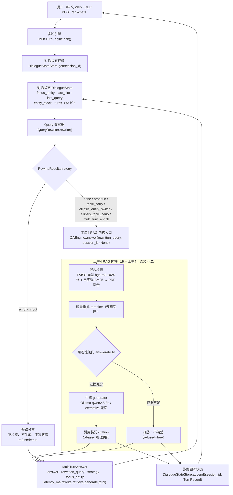
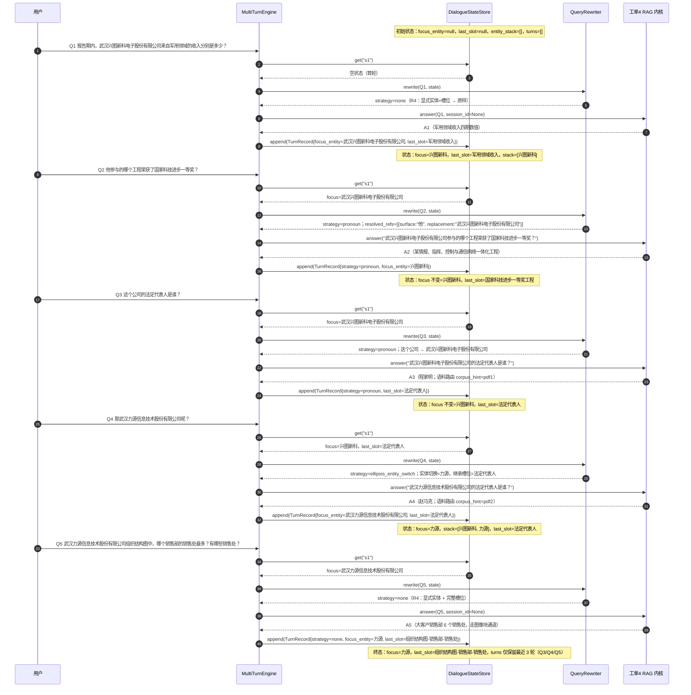

# 工单5 多轮对话架构

> 工单编号：**人工智能NLP-RAG-Query 理解优化**
> 唯一真源：`设计/接口契约_冻结.md`（模块名 / 类名 / 方法签名 / `STRATEGIES` 枚举值一律以它为准；本文件与契约冲突时**以契约为准**，并把本文件当缺陷修）。
> 基线：工单4（`E:\gao6gongdan\工单4`，**只读**）。本仓库 `研发/app/core/**` 是工单4 的只读复制，在本仓库内**可写**。
> 数字纪律：本文件**不含任何未实测的性能/准确率数字**。凡是没跑出来的，一律写「待实测」或指向 `测试/测试报告.md`；
> 引用的工单4 数字均标注来源，属**基线继承**，不是工单5 的实测结论。

---

## 0. 一句话架构

**在原 RAG 内核前面加一层「有状态的改写器」**：多轮引擎按 `session_id` 取出对话状态（焦点实体 + 字段槽位 + 最近 3 轮），
把依赖上下文的追问（「他…」「这个公司…」「那X呢？」）改写成**独立可检索的单轮问句**，
再交给工单4 的 RAG 内核原样作答，最后把答案回写进状态。

关键取舍（后面各节展开）：

| # | 取舍 | 理由 |
| --- | --- | --- |
| K1 | 改写**只做规则 + 模板**，不引入第二个大模型 | 速度优先（≤3s）、结果确定可测、离线可单测；见 `设计/技术选型.md` |
| K2 | 状态是**显式字段**（`focus_entity` / `last_slot` / `entity_stack`），不是「从上一轮问句里现捞」 | 工单4 的 `ConversationStore.resolve` 正是「现捞」，Q3/Q4 必失败（§6） |
| K3 | 多轮引擎调 `QAEngine.answer()` 时 **`session_id=None`** | 防止工单4 的 `resolve()` 对已改写问句**二次拼接**，产出「…公司这个公司的法定代表人是谁？」一类病句 |
| K4 | 状态写入顺序：**先内存后落盘、落盘 best-effort** | 落盘失败不得影响回答，也不得破坏 3 秒预算（与工单4 `ConversationStore` 同款纪律） |
| K5 | 无 `session_id` 时**逐字节直通** | 工单4 的 16 题单轮能力必须零退化（§7） |

---

## 1. 设计目标与非目标

### 1.1 目标（可判定）

| # | 目标 | 判定归属 |
| --- | --- | --- |
| G1 | 支持指代消解：`他/她/它/其/该/这个/那个/上述/前述/该公司/这家/此项/本公司` → 焦点实体 | `设计/验收标准.md` A3 |
| G2 | 支持省略式实体切换：「那X呢？」→ 继承上一轮字段槽位 | 同上 A3 |
| G3 | 支持上下文继承：问句只给字段不给主体（「法定代表人是谁？」）→ 前缀焦点实体 | 同上 A3 |
| G4 | 改写产物必须**独立可检索**：含主体、含字段、无指代词（§4.4 四条自查） | 同上 A3 |
| G5 | 多轮 5 题序列可答，准确率 ≥90%（5 题口径下等价于 5/5） | 同上 A1 |
| G6 | 单轮 16 题 **不退化** | 同上 A2 |
| G7 | 端到端 ≤3s（P50 / P95 / max 都报） | 同上 A4 |

### 1.2 非目标（明确不做，防止范围蔓延）

* 不做「多跳推理 / 跨公司对比」（如「这两家的法定代表人谁更早任职」）——本工单只做**指代与继承**。
* 不做历史摘要压缩、不做历史向量召回（工单备注已定：**只保留最近 3 轮**）。
* 不做指代**生物性别/生命度**推断（「他」在招股书语境下指法人，见 §5.2）。
* 不改工单4 的检索、重排、可答性闸门、生成、引用装配的**语义**；需要强化时只允许「多轮层」侧加约束。
* 不引入新的 Python 依赖（本机主解释器缺 `gradio` / `streamlit`，见 `设计/技术选型.md`）。

---

## 2. 分层架构图

**读图要点**

1. `BR` 是唯一的**分流点**：`empty_input` 不进 RAG（省掉整条链路），其余 6 个策略值**都要进** RAG（包括 `none`——`none` 表示「原句已独立可检索」，不是「跳过」）。
2. `CORE` 子图内所有节点都来自工单4，多轮层**不插入**任何节点；多轮唯一的插入点是 `RW` 与 `WB`。
3. `WB --> DS` 构成回路：下一轮 `get()` 拿到的是**上一轮回写后的**状态，这是 Q3/Q4 能成功的机制根源。
4. `QAE` 的 `session_id=None` 是 K3 的落地：工单4 的 `ConversationStore` 在这条路径上**不参与**，历史由多轮层自己维护（避免双重记账与二次改写）。

---

## 3. 组件清单与契约映射

| 组件 | 路径 | 契约章节 | 职责 | 状态 |
| --- | --- | --- | --- | --- |
| 对话状态 | `研发/app/core/dialogue_state.py` | 契约 §1.1 | `TurnRecord` / `DialogueState` / `DialogueStateStore`（线程安全、按 `session_id`、保留 3 轮） | 待建（契约冻结） |
| Query 改写器 | `研发/app/core/query_rewriter.py` | 契约 §1.2 | `QueryRewriter.rewrite/detect_entities/detect_slot`；R0~R4 规则；`STRATEGIES` 七值 | 待建（契约冻结） |
| 多轮引擎 | `研发/app/multiturn_engine.py` | 契约 §1.3 | `MultiTurnEngine.ask/reset/history/state/warmup/health`；装配 `MultiTurnAnswer` | 待建（契约冻结） |
| RAG 内核 | `研发/app/core/qa_engine.py` | 工单4 `设计/接口设计.md` | `QAEngine.answer(question, *, lang, top_k, session_id, return_evidence, use_cache)` | 已存在（只读复制，可写但**不改语义**） |
| 单轮弱消解 | `研发/app/core/conversation.py` | 工单4 | `ConversationStore.resolve` 前缀拼接 | 已存在；**多轮路径不经过它**（K3） |
| 问句理解 | `研发/app/core/query_understanding.py` | 工单4 | `analyze()` / `match_corpus()` / `FIELD_TERMS` / 答案形态 | 已存在；改写器**只读复用**其词表与语料白名单 |
| 索引与语料白名单 | `研发/app/core/retriever.py` | 工单4 | `build_corpus_issuers()` → `{"pdf1": [...], "pdf2": [...]}` | 已存在；`corpus_issuers` 注入改写器（§5.1） |
| 主体绑定（实现增量） | `研发/app/core/subject_binding.py` | **契约未列（实现补充模块）** | 把「字段值」绑定到正确主体：用邻近机构名 + 章节角色锚点剔除跨主体污染（研发侧实测：不做绑定时，「力源的法定代表人」会取到同页**保荐机构**的法定代表人） | 已落地；须登记为补充模块（`设计/验收标准.md` §10） |
| 评测与判分 | `测试/common/golden.py`、`测试/测试数据/多轮判分.py`、`测试/多轮/run_multiturn_eval.py` | 工单4 + 工单5 测试侧 | `judge_answer()`（单轮回归）/ `judge_case()`（多轮十维度）/ 多轮跑分器 | 已落地（契约未冻结测试侧路径，以 `设计/验收标准.md` 为准） |

> **实现增量的登记要求**：落地实现相对契约有两处**增量**（均不削减契约字段全集）——
> ① `RewriteResult.slot`（槽位骨架表示，见 `设计/Query改写流程.md` §5.6）；② `研发/app/core/subject_binding.py`（字段-主体绑定）。
> 二者必须在契约或测试报告中**显式登记**，不得靠读者从行为反推（`设计/验收标准.md` §10）。

> **不改契约地复用**：`QueryRewriter` 的构造签名 `corpus_issuers` 正是为白名单注入留的口子——实体识别**不得硬编码公司名**，
> 与工单4 `query_understanding` 的既有纪律（「发行人名字由 `corpus_issuers` 注入，代码里不写公司名」）保持一致。

---

## 4. 对话状态数据结构

### 4.1 `DialogueState` 字段语义

| 字段 | 类型 | 语义 | 写入时机 | 不变量 |
| --- | --- | --- | --- | --- |
| `session_id` | `str` | 会话键；`"default"` 为 CLI / 单窗口默认 | 首次 `get()` 惰性创建 | 非空；同一 `session_id` 全局唯一状态对象 |
| `turns` | `list[TurnRecord]` | 最近 N 轮（默认 3，最新在后） | 每轮 `append()` | `len(turns) ≤ max_turns`；超限丢最旧（丢的是**记录**，不是 `focus_entity`/`entity_stack`） |
| `focus_entity` | `str \| None` | 焦点实体 = 当前谈论的公司**全称** | 见 §5.2；无显式实体时**保持不变** | 若非空，必须 ∈ `entity_stack`；必须是语料白名单全称 |
| `last_slot` | `str \| None` | 上一轮所问的**字段槽位**（契约注释示例 `"法定代表人"`；落地实现存**槽位骨架**如 `"法定代表人是谁？"`，差异见 `设计/Query改写流程.md` §5.6） | 该轮问句能抽出槽位时更新 | 非空时**必须包含字段名**（如「法定代表人」）；不存完整原句 |
| `last_query` | `str \| None` | 上一轮的**改写后独立问句** | 每轮 `append()` | 它自身必须不含指代词（§4.4 自查 3） |
| `entity_stack` | `list[str]` | 实体栈（最近在后），用于多实体消歧与回退 | 显式实体出现时压栈 | 去重（同实体再次出现 → 移到栈顶，不重复压栈）；`len ≤ 8`（超出丢栈底） |
| `created_at` / `updated_at` | `float` | 会话创建 / 最后更新时间戳 | 创建 / 每次 `append()` | `updated_at ≥ created_at` |

### 4.2 `TurnRecord` 字段语义

| 字段 | 语义 | 判分/排障用途 |
| --- | --- | --- |
| `question` | 用户**原句**（逐字，不改写） | 回放对话；`history()` 对外展示 |
| `rewritten_query` | 该轮改写后的独立问句 | **指代消解专项验收的比对对象**（`设计/验收标准.md` A3） |
| `answer` / `ts` / `trace_id` / `cited_pages` | 答案与留痕 | 引用可回溯、日志与轮次对齐 |
| `focus_entity` | **该轮结束时**的焦点实体 | 状态演进断言（§8 时序图逐轮快照） |
| `strategy` | `STRATEGIES` 之一 | 规则命中的判定依据（不是靠人眼看句子猜） |
| `refused` | 该轮是否拒答 | 拒答红线在多轮下的传递（拒答轮仍然入账） |
| `latency_ms` | 该轮总耗时 | 与 `MultiTurnAnswer.latency_ms["total"]` 对齐 |

### 4.3 保留策略

* `max_turns=3`（契约默认）：工单备注「对话历史只保留最近 3 轮」的落地。Q1→Q5 五轮序列下，跑到 Q5 时 `turns` 只含 Q3/Q4/Q5，但 **`focus_entity` / `last_slot` / `entity_stack` 不受裁剪影响** —— 这正是「状态化」相对「翻历史」的核心优势（否则 Q1 的实体在第 4 轮就被裁掉了）。
* `max_sessions=200`：超过后按 `updated_at` 最旧淘汰，**不淘汰当前正在写入的会话**。
* `persist_dir`（可选）：内存为主、落盘为辅。落盘异常记 `WARNING` 后继续（禁止因落盘失败把一次成功的问答变成失败）。

### 4.4 改写产物的四条自查（`rewritten` 必须同时满足）

| # | 自查 | 反例 |
| --- | --- | --- |
| 1 | **含主体**：能命中 `corpus_issuers` 白名单（`match_corpus` 返回唯一语料）或本身是通用问句 | 「这个公司的法定代表人是谁？」 |
| 2 | **含字段**：能抽出槽位，或原句本身就是完整问句（`none` 分支） | 「那武汉力源信息技术股份有限公司呢？」 |
| 3 | **无指代词**：R2 词表在改写后**不再命中** | 「武汉兴图新科电子股份有限公司他参与…」 |
| 4 | **不膨胀**：长度 ≤ 原句 + 实体全称长度 × 命中次数 + 模板开销（≈12 字） | 对同一指代反复替换导致句子重复 |

---

## 5. 焦点实体（focus entity）机制

### 5.1 什么算「显式实体」（`detect_entities` 的判定口径）

1. **来源是白名单**：`corpus_issuers = {"pdf1": [...], "pdf2": [...]}`，由 `retriever.build_corpus_issuers()` 从**索引块内容自动统计**，
   代码里**不得**出现任何公司名字面量（沿用 `query_understanding` 的既有纪律）。
2. **匹配方式**：候选名与其**去修饰核心词**（去掉 `武汉 / 股份有限公司 / 有限公司 / 电子` 等）双向匹配；
   命中即返回**白名单全称**（`力源` → `武汉力源信息技术股份有限公司`）。
3. **白名单外不入选**：未命中白名单的名词串（如「某某科技有限公司」）**只在本轮就近使用，不入栈、不设焦点**。
   这条规则同时防住工单4 已知限制①（泛化名/占位名污染）在多轮里的**放大**——否则一次误识别会污染后续所有指代轮。
4. **最长匹配优先**：同一句命中多个候选时取最长者（`武汉力源信息技术股份有限公司` 优先于 `力源`）。

### 5.2 何时**更新**焦点实体

| # | 触发场景 | 动作 | 依据 |
| --- | --- | --- | --- |
| U1 | 问句含显式实体，且与当前焦点**不同** | 压栈 + 设焦点（**实体切换**） | 契约「显式实体出现 → 入栈并设焦点」；Q4 的机制 |
| U2 | 问句含显式实体，且与当前焦点**相同** | 焦点不变；`entity_stack` 把该实体**移到栈顶**（不重复压栈） | 去重不变量（§4.1） |
| U3 | 问句只含指代词（R2 命中） | **保持不变**（焦点就是被指代的对象） | Q2/Q3 的机制 |
| U4 | 问句只含槽位（R3 命中） | **保持不变** | 「法定代表人是谁？」的机制 |
| U5 | 问句同含显式实体**与**指代词 | 以**显式实体**为准（R4 分支：原样 + 更新焦点） | 显式意图优先于指代 |
| U6 | 空输入（R0） | **不更新、不写状态** | 空轮不得污染会话（§7 降级矩阵 D5） |
| U7 | 该轮被拒答（`refused=true`，实体来自白名单） | **仍然更新**：实体是用户的**显式**话题切换意图 | 否则用户切换话题被拒答后，下一轮指代会指回旧公司（更难排障） |
| U8 | 该轮被拒答且未识别到白名单实体 | 不更新 | 与 §5.1 第 3 条一致 |

### 5.3 何时**保持**焦点实体

指代轮（U3）、槽位轮（U4）、无实体无槽位的兜底轮、拒答轮（无实体）——统称「**保持轮**」。
保持轮**不做任何**焦点读写，这使得：

* 「他/这个公司」总是解析到**最近一次显式提及**的公司；
* 连续多轮追问（Q2→Q3）**不需要**在中间轮重复公司名；
* 状态可解释：`entity_stack` 的长度变化就是「用户切换过几次话题」的可观测计数。

### 5.4 多实体同时出现时的消歧（顺序敏感）

| 序 | 规则 | 说明 |
| --- | --- | --- |
| 1 | **白名单过滤** | 非白名单实体一律不参与消歧（避免占位名抢焦点） |
| 2 | **最长匹配优先** | 嵌套（`武汉力源信息技术股份有限公司` ⊃ `力源`）取长的 |
| 3 | **就近取最后** | 同轮多个**不同**白名单实体 → 取**位置最后**的那个，代表「用户最新的关注点」；并在 `notes` 记 `multi_entity` |
| 4 | **跨语料冲突不切换** | 同轮实体分别命中 pdf1 与 pdf2（`match_corpus` 返回 `(None, None)`）→ **不切换焦点**，把语料选择交回工单4 的 `corpus_hint` 逻辑，避免多轮层越权做语料裁决 |
| 5 | **回退用栈** | 若焦点为空但 `entity_stack` 非空（异常路径）→ 取栈顶兜底，并记 `notes="focus_recovered_from_stack"` |

### 5.5 与工单4 语料路由的协同

改写后问句**显式含公司全称**，于是工单4 的 `query_understanding.match_corpus()` 能正常命中 `corpus_hint` / `issuer_hint`：

* Q3 改写前 → 无 issuer_hint（跨两份 PDF 检索，易串答）；
* Q3 改写后 → `corpus_hint="pdf1"`，检索被约束到 `招股说明书1.pdf`。

也就是说，多轮层的收益**不止**「补主体」，还包括**让工单4 已有的语料路由重新生效**——这是 Q3/Q4 之前失败的一个直接技术原因（§6）。

---

## 6. 与工单4 `ConversationStore.resolve` 的差异对比

### 6.1 机制对比

| 维度 | 工单4 `ConversationStore.resolve`（`研发/app/core/conversation.py`） | 工单5 `QueryRewriter` + `DialogueState` |
| --- | --- | --- |
| 状态载体 | 只有 `Turn` 列表（`question` / `answer` / `ts`）；**没有实体状态、没有槽位状态** | `DialogueState`：`focus_entity` / `last_slot` / `last_query` / `entity_stack` / `turns` |
| 补全的信息源 | 上一轮**问句文本**里的 `_SUBJECT` 正则命中（`[4-20 汉字](股份有限公司\|有限公司)`） | 状态里的 `focus_entity`（与上一轮**措辞无关**） |
| 指代词表 | `它\|其\|该\|这个\|那个\|上述\|前述\|该公司\|本项目\|这家\|此项`（**无「他/她/本公司」**） | 契约 R2 词表，**含「他/她/本公司」**（Q2 必需） |
| 触发条件 | 有指代词 **且 当前问句不含公司全称** → 才去看上一轮 | 按 R0~R4 顺序判定，**显式实体/指代/槽位三分**，顺序敏感且可枚举 |
| 省略式（「那X呢？」） | **不支持**（`那` 不在词表；无槽位继承概念） | `ellipsis_entity_switch`：实体切换 + **继承上一轮槽位** |
| 槽位继承 | **无此概念** | `last_slot` 显式继承（Q4 = 继承 Q3 的「法定代表人」） |
| 改写产物 | `subject + question` **前缀拼接**，产出病句（指代词仍在句内） | 指代词**替换** + 模板补全，产出**独立可检索问句** |
| 多实体切换 | 无法切换（没有栈） | `entity_stack` 入栈/置顶，显式切换 |
| 可观测性 | 返回 `(question, bool)`；只有 `anaphora_used` 一个布尔 | `RewriteResult`：`strategy` / `changed` / `focus_entity_before/after` / `inherited_slot` / `resolved_refs` / `notes` |
| 无 `session_id` | 直通返回原句 | 直通返回原句（`strategy="none"`、`changed=false`）**且不写状态** |

### 6.2 五个用例在工单4 路径下的推演（**为什么必须做状态化**）

> 推演依据：`conversation.py` 的 `_ANAPHORA`（§6.1 词表）与 `_SUBJECT`、`pending_subject()`（**只扫上一轮的问句**）、`resolve()` 的三个提前返回分支。

| 轮 | 原句 | 工单4 路径的实际行为 | 结果 |
| --- | --- | --- | --- |
| Q1 | 报告期内，武汉兴图新科电子股份有限公司来自军用领域的收入分别是多少？ | `_SUBJECT` 命中 → `resolve` 提前返回「问句已含主体」→ 单轮检索 | ✅ 与单轮等价（不依赖多轮） |
| Q2 | **他**参与的哪个工程荣获了国家科技进步一等奖？ | `_ANAPHORA` **不含「他」** → 无指代 → 直通 | ⚠️ **不发生消解**；问句无主体 → `match_corpus` 得不到 `issuer_hint` → 语料不路由（可能跨两份 PDF 检索）。是否答对取决于关键词是否碰巧命中，**不是可依赖能力** |
| Q3 | **这个公司**的法定代表人是谁？ | `_ANAPHORA` 命中「这个」→ 但 `pending_subject` 取的是**上一轮（Q2）问句**里的公司全称，而 Q2 问句里**没有公司全称** → `None` → 直通 | ❌ **失败**：检索式里「这个公司」不是任何语料主体，`corpus_hint` 为空，法定代表人（PDF1 物理页 22）无法被定向召回 |
| Q4 | **那**武汉力源信息技术股份有限公司**呢**？ | `_ANAPHORA` **不含「那」** → 直通（问句虽含全称，但**没说问什么字段**） | ❌ **失败**：无论检索到哪一页，都无法判断用户要的是「法定代表人」这个字段 |
| Q5 | 武汉力源信息技术股份有限公司组织结构图中，哪个销售部的销售处最多？有哪些销售处？ | 显式实体 + 完整字段 → 单轮可答（依赖工单4 的图像通道） | ✅ 与单轮等价（不依赖多轮） |

**结论**：工单4 的补全能力**被绑定在「上一轮的措辞」上**，而多轮追问的本质是「**上一轮的话题**」。
Q2 已经把「公司全称」从对话里挤出去了（用户用「他」代替），Q3 因此拿不到主体；Q4 甚至连「问什么」都没有。
→ 因此工单5 必须把「话题」升级为**一等公民的状态字段**（`focus_entity` + `last_slot` + `entity_stack`），
而不是每轮去正则扫上一轮问句。这就是本工单架构增量的**全部必要性**。

---

## 7. 多轮 → 单轮的降级路径（保证工单4 不退化）

### 7.1 降级矩阵

| # | 条件 | 行为 | 保证 |
| --- | --- | --- | --- |
| D1 | `session_id` 为空 / `None` | **逐字节直通**：`rewritten == question`，`strategy="none"`，`changed=false`；**不读也不写**状态 | 单轮调用语义与工单4 **完全一致** |
| D2 | `session_id` 有值但状态为**空**（首轮） | 只做 R4/R3 判定；焦点为空时**不做**任何指代替换；`notes="no_focus_entity"` | 首轮永不因多轮层而改写失败 |
| D3 | 状态损坏 / 反序列化失败（落盘脏数据） | 丢弃该会话状态并重建为空状态，记 `WARNING`；本轮按 D2 处理 | 坏状态不阻塞问答 |
| D4 | 改写抛异常 | 捕获 → `rewritten = question`、`strategy="none"`、`notes="rewrite_failed:<类型>"`；**异常不得外泄** | 多轮层永不让一次问答整体失败 |
| D5 | 空输入 / 纯空白 / 纯符号（R0） | `strategy="empty_input"`；**不调 RAG、不写状态**；返回 `refused=true` + 固定提示语 | 空轮不污染状态，也不占用 3s 预算 |
| D6 | 指代词命中但无焦点实体 | 原样放行（`strategy="none"`，`notes="no_focus_entity"`） | 交回工单4 的**可答性闸门**决定拒答，多轮层不越权编造主体 |
| D7 | 省略式命中但 `last_slot` 为空 | 原样放行（`strategy="none"`，`notes="no_slot_to_inherit"`） | 同上 |
| D8 | `use_cache=False`（延迟测量口径） | 透传给 `QAEngine.answer(use_cache=False)`；**改写本身无缓存**（纯规则，无需缓存） | 延迟口径与工单4 可比 |
| D9 | 生成/检索链路异常（Ollama 不可用等） | 由工单4 既有降级（extractive 兜底 / 结构化错误）处理；多轮层只负责把异常映射进 `MultiTurnAnswer` 并保持字段完整 | 不新增崩溃点 |

### 7.2 「不退化」的三条论证

1. **路径级**：D1 是逐字节直通，且 `MultiTurnEngine` 只在 `session_id` 非空时才实例化 `QueryRewriter` 的语义分支——
   单轮 16 题的调用（`--ask` 不带 `--session-id`）与工单4 走的是**同一条** `QAEngine.answer` 调用。
2. **口径级**：单轮回归用**同一套**判分器（`测试/common/golden.py::judge_answer`）与**同一个**驱动（`测试/在线/run_16q_eval.py`），
   阈值与工单4 一致（16 题 ≥90%，逐题 ≤3000 ms），**不新建更松的尺子**。
3. **证据级**：回归结论以 `测试/测试数据/accuracy_report.json`（多轮改造后**重跑**的产物）为准，见 `设计/验收标准.md` A2。

---

## 8. 五轮状态演进时序图（Q1 → Q5）

**逐轮策略一览**（判分口径见 `设计/验收标准.md` A1/A3）：

| 轮 | 原句要点 | `strategy` | 焦点（改前 → 改后） | 继承槽位 | 改写后问句 |
| --- | --- | --- | --- | --- | --- |
| Q1 | 武汉兴图新科…军用领域收入 | `none` | ∅ → 兴图新科 | 无（本轮新抽） | 原句（不改写） |
| Q2 | 他参与的…国家科技进步一等奖 | `pronoun` | 兴图新科 → 兴图新科 | 无 | 武汉兴图新科**电子股份有限公司**参与的哪个工程荣获了国家科技进步一等奖？ |
| Q3 | 这个公司的法定代表人是谁？ | `pronoun` | 兴图新科 → 兴图新科 | 无 | 武汉兴图新科电子股份有限公司的法定代表人是谁？ |
| Q4 | 那武汉力源…呢？ | `ellipsis_entity_switch` | 兴图新科 → **力源** | **法定代表人** | 武汉力源信息技术股份有限公司的法定代表人是谁？ |
| Q5 | 力源组织结构图…销售处 | `none` | 力源 → 力源 | 无（本轮新抽） | 原句（不改写） |

> 逐条推导（含命中规则、`resolved_refs`、边界判定）见 `设计/Query改写流程.md` §5。

---

## 9. 性能预算与耗时分解（设计目标，非实测）

| 段 | 预算 | 依据 |
| --- | --- | --- |
| `rewrite` | **目标 ≤5 ms**（纯本地规则：正则 + 白名单匹配，无网络、无模型调用、无 I/O） | 规则改写是 O(问句长度) 的字符串操作；**待实测** |
| 状态读写 | 内存字典 + 单锁，**目标 ≤1 ms**；落盘 best-effort 在关键路径外 | 与工单4 `ConversationStore` 同款实现规模；**待实测** |
| `retrieve` + `generate` | **沿用工单4 基线**（工单4 交付实测：预热 + 独占 Ollama 下 16 题逐题 total P50 595.8 / P95 929.8 / max 1062.8 ms，来源 `测试/测试报告.md`） | 多轮层**不修改**该链路；该数字是**工单4 基线继承**，不是工单5 实测 |
| `total` | **≤3000 ms**（验收线） | `设计/验收标准.md` A4；多轮 5 题逐题 P50/P95/max **待实测** |

**必须成立的口径前提**（与工单4 一致）：① 服务已完成预热；② **独占 Ollama**；③ 同一窗口不并发跑其它评测；
④ 缓存命中/未命中**分别统计**。若多轮出现超线，先查这三条前提，再查实现。

---

## 10. 并发、持久化与可观测性

| 主题 | 设计 |
| --- | --- |
| 线程安全 | `DialogueStateStore` 内部单一 `threading.Lock` 保护 `_sessions` 字典；`get()` 惰性创建；`append()` 原子（裁剪 + 时间戳 + 落盘登记在同一临界区内完成内存部分） |
| 同会话并发 | HTTP 线程池可能并发命中同一 `session_id` → **last-write-wins**（后到者覆盖 `focus_entity`/`last_slot`）。此为**已知取舍**，需在 `测试/测试报告.md` 登记；Web 层应保证「同一浏览器会话 = 同一 `session_id`」以规避 |
| 跨进程 | 进程内状态**不跨进程共享**。多 worker 部署下同一 `session_id` 会落到不同进程 → 契约要求 `POST /api/chat` 单进程运行（`uvicorn` 默认单 worker），**不得**用 `--workers >1` 跑多轮 |
| 持久化 | `persist_dir` 可选落盘（供重启后恢复与排障）；**落盘不是正确性依赖**：读不到就从空状态开始，写失败只记 `WARNING` |
| 日志 | 每轮记结构化事件：`multiturn.rewrite`（`strategy` / `changed` / `focus_before` / `focus_after` / `inherited_slot` / `resolved_refs` / `notes`）、`multiturn.turn_appended`（`turn_index` / `focus_entity` / `last_slot` / `refused` / `total_ms`）；复用 `研发/app/core/logging_conf.py` |
| 可回溯 | `MultiTurnAnswer.trace_id` ← 底层 `Answer.trace_id`；`TurnRecord.trace_id` 与之对齐，保证「一轮问答 → 一条日志链」 |
| 健康检查 | `MultiTurnEngine.health()` 返回索引块数 / 生成后端 / Ollama 可达性 / 会话数 / `STRATEGIES` 版本号；`warmup()` 复用 `QAEngine.warmup` |

---

## 11. 术语与引用

| 术语 | 含义 |
| --- | --- |
| 焦点实体 focus entity | 当前对话正在谈论的公司**全称**（白名单口径） |
| 字段槽位 slot | 用户「问的是什么字段」的归一化名，如 `法定代表人` / `军用领域收入` / `组织结构图-销售部-销售处` |
| 独立问句 | 不含指代词、含主体与字段、可**脱离对话**直接检索的问句 |
| 保持轮 | 只含指代或只含槽位的轮次：焦点不变 |
| 短路分支 | `strategy="empty_input"`：不进 RAG 的唯一天然分支 |

| 引用 | 用途 |
| --- | --- |
| `设计/接口契约_冻结.md` §1 | 模块/类/方法签名/`STRATEGIES` 的唯一真源 |
| `设计/Query改写流程.md` | R0~R4 判定、指代词表、槽位抽取、五用例逐轮推导、边界与失败模式 |
| `设计/技术选型.md` | 生成/嵌入/向量库/改写策略/历史策略/Web/缓存的选型与放弃理由 |
| `设计/验收标准.md` | 多轮 5 题与单轮 16 题的判定方法、证据文件、延迟口径、截图清单 |
| `设计/工单需求原文.md` | 本工单需求逐字副本（唯一需求来源） |
| `研发/app/core/conversation.py`、`研发/app/core/query_understanding.py` | 工单4 基线实现（对比对象） |
| `测试/测试报告.md`、`测试/测试数据/accuracy_report.json` | 全部实测数字的唯一来源 |
