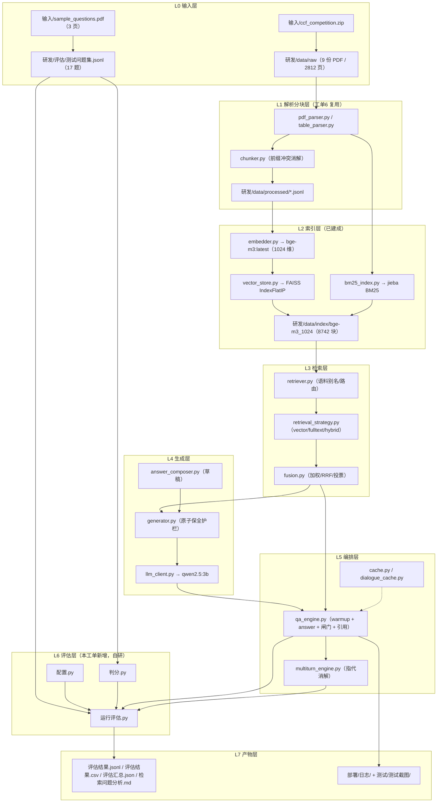

# 工单7 测试评估架构

> **工单编号：人工智能NLP-RAG-功能测试及评估**
> 仓库：`E:\gao6gongdan\工单7`（= **工单6「人工智能NLP-RAG-图像内容解析及检索优化」的复制副本**，`研发/app/**` 保留工单6 全量实现）
> 文档定位：说清「**测试与评估这条链**」的分层结构、模块职责、数据流与失真风险。
> 数字纪律：本文出现的每个数字都能在 **§9 数字来源对照表** 指到具体文件与字段；**不确定的数字一律不写**，或写「以 `研发\data\index\index_manifest.json` 实测为准」。
> 口径来源：`设计\工单7环境事实.md`（事实文档）、`研发\data\index\index_manifest.json`（索引实测）、`研发\评估\测试问题集.jsonl`（题库）、`测试\测试数据\关键词核对结果.json`（关键词核对实测）。

---

## 0. 本工单做什么 / 不做什么

| 维度 | 内容 |
| --- | --- |
| **做什么** | 把工单6 的 RAG 链路**原样搬到 CCF 年报语料**上，做**功能测试**（端到端问答、多轮、异常输入）与**评估**（准确率/覆盖率/召回/页命中/泄漏/延迟/拒答），产出可复核的 CSV/JSON 与分析报告 |
| **不做什么** | 不重写检索算法、不训练模型、不引入新依赖（本机无 `ragas` / `pandas` / `gradio`）、**不装新包**、不改 `研发/app/core/**` 的检索与生成语义 |
| **评估框架** | **自研**（本机无 RAGAS），代码规划落在 `研发\评估\`：`配置.py` / `判分.py` / `运行评估.py` ★ |
| **已知缺口** | 图像块为 **0**（本机缺 `cv2` / `onnxruntime` 且未缓存中文 CLIP 权重 → 图像解析链路不可用），属**如实登记的降级**，见 §7.4 |
| **只读红线** | **严禁写入** `工单1` / `工单2` / `工单3` / `工单6`（既有资产只读复用） |

> ★ **落地状态（已与代码核对）**：`研发\评估\` 目录下**四个文件均已落盘**——
> `测试问题集.jsonl`（题库真源）、`配置.py`（常量与路径）、`判分.py`（纯函数判分，可独立跑自检）、
> `运行评估.py`（主入口：预热 → 逐题 → 判分 → 汇总 → 落盘）。
> 本文的函数名、配置常量名、汇总键名、产物名、退出码语义**均取自实际代码**（对照表见 `设计\评估流程图.md` §8）；
> 若后续实现变更，**先改事实文档（本文与指标文档），再改报告**，不得反向迁就。

---

## 1. 分层架构

### 1.1 框图（ASCII 框线）

```text
┌──────────────────────────────────────────────────────────────────────────────────────┐
│ L0 输入层                                                                             │
│   输入\sample_questions.pdf（3 页示例题）        输入\ccf_competition.zip（46 504 897 B）│
│        │  （人工整理为题库，不用 pdfplumber）          │  测试\解压语料.py（cp437→gbk）    │
│        ▼                                              ▼                                │
│  研发\评估\测试问题集.jsonl（17 题）              研发\data\raw\*.pdf（9 份 / 2812 页）  │
└───────────────┬──────────────────────────────────────┬───────────────────────────────┘
                │                                      │
                │                                      ▼
                │                        ┌──────────────────────────────────────────┐
                │                        │ L1 解析/分块层（工单6 原样复用）           │
                │                        │  pdf_parser.py（pymupdf 文本通道）        │
                │                        │  table_parser.py（表格结构化）            │
                │                        │  image_parser/chart_extractor/diagram_parser│
                │                        │      └─ 本机不可用（图像块 = 0，已知缺口） │
                │                        │  chunker.py（分块 + chunk_id；本工单改前缀）│
                │                        │  → 研发\data\processed\*.jsonl + chunks.jsonl│
                │                        └───────────────────┬──────────────────────┘
                │                                            ▼
                │                        ┌──────────────────────────────────────────┐
                │                        │ L2 索引层（已构建完成）                    │
                │                        │  embedder.py → Ollama `bge-m3:latest`     │
                │                        │               （1024 维）                 │
                │                        │  vector_store.py → FAISS IndexFlatIP      │
                │                        │  bm25_index.py  → jieba 分词 BM25         │
                │                        │  产物：研发\data\index\bge-m3_1024\        │
                │                        │   8742 块 = 文本 7325 + 表格 1417 + 图像 0 │
                │                        └───────────────────┬──────────────────────┘
                │                                            │
                ▼                                            ▼
┌──────────────────────────────────────────────────────────────────────────────────────┐
│ L3 检索层（工单6 复用；本工单仅加「文件名派生别名 → 语料路由」）                        │
│   retriever.py（retrieve / hybrid_search；build_corpus_issuers / corpus_key_of_file）  │
│   retrieval_strategy.py（vector / fulltext / hybrid 三模式）                            │
│   fusion.py（加权平均 / RRF / 投票）  fulltext_query.py（倒排 + DSL）  reranker.py       │
│   → 命中片段（chunk_id / page / modality / final_score）                                │
└───────────────────────────────────────────┬──────────────────────────────────────────┘
                                            ▼
┌──────────────────────────────────────────────────────────────────────────────────────┐
│ L4 生成层（工单6 复用，未改动）                                                        │
│   answer_composer.py（确定性草稿）→ generator.py（LLM 润色 + **原子保全护栏**）          │
│   llm_client.py → Ollama `qwen2.5:3b`（不可用时降级 extractive 后端）                    │
│   护栏未过 ⇒ 回退规则拼接草稿（数字正确、可读性下降 —— 见 §7.3）                          │
└───────────────────────────────────────────┬──────────────────────────────────────────┘
                                            ▼
┌──────────────────────────────────────────────────────────────────────────────────────┐
│ L5 编排层（工单6 复用，未改动；评估侧通过其公开入口调用）                                │
│   qa_engine.py    QAEngine.warmup(with_generate=True) / .answer(...) → Answer           │
│                   可答性闸门 answerability.py（min_keyword_coverage=0.45 / min_score=0.35，工单7 标定）│
│                   citation.py（引用页，1-based 物理页码）                                │
│   multiturn_engine.py  MultiTurnEngine.ask(...) → rewritten_query / strategy / focus_entity│
│   cache.py / dialogue_cache.py（缓存；评估须 use_cache=False 取全量口径）                 │
│   logging_conf.py（WORK_ORDER 已同步；日志与 trace 是交付物的一部分）                     │
└───────────────────────────────────────────┬──────────────────────────────────────────┘
                                            ▼
┌──────────────────────────────────────────────────────────────────────────────────────┐
│ L6 评估层（**本工单新增，自研**；落在 研发\评估\）                                       │
│   配置.py    题库/索引/输出路径、阈值与开关（TOP_K=10 / RECALL_KS=(5,10) / SLA_MS=3000）│
│   判分.py    归一化(含数字边界) + 关键词覆盖率 + 严格判对/部分正确 + recall@K            │
│              + 页命中 + 跨语料泄漏(top3/top10/引用级) + 引用泄漏（纯函数，禁 LLM 自评）   │
│   运行评估.py 预热 + 逐题 QAEngine.answer(use_cache=False) + 索引可达性诊断              │
│              → 落盘 JSONL/CSV/汇总/问题分析 + 控制台日志                                 │
└───────────────────────────────────────────┬──────────────────────────────────────────┘
                                            ▼
┌──────────────────────────────────────────────────────────────────────────────────────┐
│ L7 产物/留痕层                                                                        │
│   测试\测试数据\评估结果.jsonl / 评估结果.csv / 评估汇总.json / 检索问题分析.md            │
│   测试\测试数据\关键词核对结果.json（103 关键词核对，通过率 100%）                        │
│   部署\日志\app.log / error.log / rag_trace.jsonl   测试\测试截图\*.png                  │
└──────────────────────────────────────────────────────────────────────────────────────┘
```

### 1.2 同一张图的 Mermaid 版（便于渲染）



---

## 2. 模块职责表（代码文件 ↔ 职责 ↔ 工单7 是否改动）

> 「是否改动」只承认以下 **5 类改动**（与 `设计\工单7环境事实.md` §1 一致）：
> ① `config.py` 的 `WORK_ORDER`；② `logging_conf.py` 的 `WORK_ORDER`；③ `chunker.py` 的**前缀冲突消解**；
> ④ `retriever.py` 的**语料别名与路由**；⑤ `scripts/build_index.py` 的 `EXPECTED_PAGES` / `--allow-empty-images` / `--reuse-chunks` 一致性；
> 另加 **⑥ 新增 `研发\评估\*`**（测试侧）。
> **除此之外一律「未改动」**——包括检索算法、生成护栏、闸门阈值、缓存与接口契约。

### 2.1 解析 / 分块 / 索引

| 代码文件 | 职责 | 工单7 是否改动 | 依据 |
| --- | --- | --- | --- |
| `研发\app\core\pdf_parser.py` | PDF 解析（**pymupdf**）：文本块 + 表格 + 图像三通道；页页 1-based 物理页码 | **未改动** | 工单6 原样复用 |
| `研发\app\core\table_parser.py` | 表格结构化（表头去重、跨页续接、退化表识别） | **未改动** | 同上 |
| `研发\app\core\image_parser.py`、`chart_extractor.py`、`diagram_parser.py`、`multimodal_encoder.py` | 图像内容解析（CLIP 零样本 / 几何 + 锚点 / 像素抽取） | **未改动**（本机链路不可用） | 缺 `cv2`/`onnxruntime`、无中文 CLIP 权重 → 图像块 0（§7.4） |
| `研发\app\core\chunker.py` | 分块与 `chunk_id` 生成 | **★ 已改动**：新增 `register_corpus_names()` / `corpus_prefix()`，`chunk_id_for()` 取用消解后前缀 | 实测：`2022-03-28` 的**招商证券**与**中国太保**安全化后同为 `20220328` → chunk_id 撞车、建索引硬失败（§7.2） |
| `研发\app\core\embedder.py` | 嵌入调用（Ollama `bge-m3:latest`，**1024 维**） | **未改动** | 索引 manifest `embed_dim=1024` |
| `研发\app\core\embedding_models.py` | 多嵌入模型注册表（`bge-m3` / `m3e-base` 等） | **未改动** | 工单6 交付 |
| `研发\app\core\vector_store.py` | 向量库读写与检索（**FAISS `IndexFlatIP`**，numpy 等价兜底） | **未改动** | manifest `vector_backend="faiss:IndexFlatIP"` |
| `研发\app\core\bm25_index.py` | BM25 稀疏索引（**jieba** 分词） | **未改动** | manifest `bm25.k1=1.5` / `b=0.75` |
| `研发\app\core\text_utils.py` | 分词、停用词、文本工具 | **未改动** | — |
| `研发\scripts\parse_corpus.py` | 批量解析驱动 | **未改动** | — |
| `研发\scripts\build_index.py` | 建索引主驱动（解析→分块→嵌入→FAISS→BM25→manifest→校验） | **★ 已改动**：① `EXPECTED_PAGES` 换成本工单 9 份语料实测页数；② 新增 `--allow-empty-images`（图像块为 0 时由硬失败降级为 WARNING）；③ `--reuse-chunks` 下调用前缀消解并**就地重写**已复用的旧 `chunk_id`（`_rewrite_colliding_ids`）；④ manifest 写入 `corpus_keys`（文件名 → 语料键），供检索层按语料路由 | §7.2 / §7.4；`EXPECTED_PAGES = {265,342,351,421,370,235,264,278,286}` |
| `研发\scripts\build_index_multi.py`、`extract_images.py`、`download_clip.py` | 多模型建索引 / 图像抽取 / CLIP 权重下载 | **未改动**（后两者本工单未使用） | — |

### 2.2 检索 / 生成 / 编排

| 代码文件 | 职责 | 工单7 是否改动 | 依据 |
| --- | --- | --- | --- |
| `研发\app\core\retriever.py` | 混合检索入口（`retrieve()` / `hybrid_search()`）+ 语料路由 | **★ 已改动**：新增 `issuer_aliases_from_filename()` / `build_corpus_issuers()`（**从文件名派生**公司简称与全称）/ `corpus_key_of_file()`；别名并入 `IndexBundle.corpus_issuers` 供问句→语料过滤 | 实测缺陷：问「平安银行2019年营业收入」**曾引用招商银行 p53**（§7.1） |
| `研发\app\core\retrieval_strategy.py` | 三模式检索策略层（`vector` / `fulltext` / `hybrid`）+ 预热 | **未改动** | 工单6 交付；评估可显式传策略 |
| `研发\app\core\fusion.py` | 融合算法（加权平均 / RRF / 投票） | **未改动** | 工单6 交付 |
| `研发\app\core\fulltext_query.py` | 自实现倒排索引 + 查询 DSL + 多字段 | **未改动** | 工单6 交付 |
| `研发\app\core\reranker.py` | 召回后重排（规则 / TF-IDF / CrossEncoder） | **未改动** | 工单6 交付 |
| `研发\app\core\llm_client.py` | Ollama 客户端（探测 / 调用 / 降级） | **未改动** | — |
| `研发\app\core\generator.py` | 生成器：确定性草稿 + LLM 润色 + **原子保全护栏**（`verify_and_repair_draft` / `numeric_pairs` / `numbers_preserved`） | **未改动** | 护栏行为是 §7.3 的失真来源，但**本工单不改它** |
| `研发\app\core\answer_composer.py` | 抽取式草稿拼装 | **未改动** | — |
| `研发\app\core\answerability.py` | 可答性闸门（`keyword_coverage_of` / `evaluate_answerability`；`thresholds` 取自 `config.answer`：`min_score=0.35`、`min_keyword_coverage=0.45`、`min_vector_similarity_en=0.45`） | **未改动**（阈值由配置层标定，见 §9） | 「拒答率」指标的解释依赖这些阈值 |
| `研发\app\core\citation.py` | 引用构造（`build_citations` / `cited_pages`；1-based 物理页码） | **未改动** | 「无引用率」指标的解释依赖它 |
| `研发\app\core\qa_engine.py` | 端到端编排：预热 → 指代消解 → 问句理解 → 缓存 → 检索 → 闸门 → 生成 → 引用；`Answer` 结构体 | **未改动**（评估侧只调用 `warmup()` / `answer()`） | 冷启动首字可达 **3.4 s** ⇒ **必须预热**（§7.5） |
| `研发\app\multiturn_engine.py` | 多轮引擎（`ask()` → `rewritten_query` / `strategy` / `focus_entity`） | **未改动** | 多轮回归用例的设计依据 |
| `研发\app\core\conversation.py`、`dialogue_state.py`、`query_rewriter.py`、`query_understanding.py`、`history_compress.py`、`subject_binding.py`、`language.py` | 会话状态 / 指代消解 / 改写 / 问句理解 / 历史压缩 / 主体绑定 / 语言判定 | **未改动** | 工单5/6 交付 |
| `研发\app\core\cache.py`、`dialogue_cache.py` | 问题级内存缓存 + 答案级落盘缓存 | **未改动** | 评估须 `use_cache=False` 才拿全量口径 |
| `研发\app\core\errors.py` | 统一错误类型（`IndexMissingError` / `LLMProbeError` 等） | **未改动** | 异常分支返回码设计的依据 |
| `研发\app\core\config.py` | 配置树（路径 / LLM / 检索 / 答案阈值） | **★ 已改动**：`WORK_ORDER` = `"人工智能NLP-RAG-功能测试及评估"`，新增 `BASELINE_WORK_ORDER` = `"人工智能NLP-RAG-图像内容解析及检索优化"`；`work_order` 字段随之写入 | 身份标识，**不改任何阈值/默认值** |
| `研发\app\core\logging_conf.py` | 结构化日志（`work_order` 字段是交付物的一部分） | **★ 已改动**：`WORK_ORDER` 同步为本工单编号 | 日志与工作单号一致 |
| `研发\app\core\prompts\*.txt`、`prompts_loader.py` | 提示词模板 | **未改动** | — |
| `研发\app\main.py`、`chat_cli.py`、`ui\*`、`storage\*` | CLI / 界面 / SQLite 存储 | **未改动**（本工单评估走直调引擎路径） | — |

### 2.3 测试与评估（本工单新增）

| 文件 | 职责 | 状态 |
| --- | --- | --- |
| `研发\评估\测试问题集.jsonl` | **题库真源**：17 题，字段 `id/question/lang/source_pdf/source_file/expected_pages_hint/reference_answer/answer_keywords/project` | ✅ 已落盘（**17 行**） |
| `研发\评估\配置.py` | 评估口径常量与路径：`QUESTION_SET` / `OUT_DIR`(`测试\测试数据`) / `INDEX_MANIFEST` / `INDEX_MIN_CHUNKS=8000`；`TOP_K=10` / `PROMPT_TOP_K=3` / `RECALL_KS=(5,10)`；`USE_CACHE=False` / `SESSION_PREFIX="eval7"`；`KEYWORD_THRESHOLD=0.6` / `PARTIAL_THRESHOLD=0.3` / `ATOMIC_THRESHOLD=0.6`；`SLA_MS=3000`；`LEAK_TOP_N=3`；`EXPECTED_CORPUS_COUNT=9`；`OUT_FILES`（五件产物）；`apply_env()` / `ensure_out_dir()` | ✅ 已落盘 |
| `研发\评估\判分.py` | **纯函数判分**（不依赖索引/模型/网络，可独立 import 并跑内置自检）：`normalize` / `keyword_coverage` / `is_correct` / `partial_correct` / `atomic_coverage` / `numeric_atoms` / `retrieval_recall_at_k` / `parse_page_ranges` / `page_hit` / `cross_corpus_leak` / `citation_leak` / `split_source_files` / `company_of` / `companies_of` / `classify_question`；含**数字边界**防假阳性（`11.65` 不命中 `1.65`） | ✅ 已落盘（`python 研发\评估\判分.py` 跑自检） |
| `研发\评估\运行评估.py` | 评估主入口：`load_questions` → `QAEngine.warmup(with_generate=True)` → `evaluate_one`（逐题、串行、`use_cache=False`）→ `build_index_reach`（索引全库可达性诊断）→ `build_summary` / `build_analysis` → `write_jsonl` / `write_csv` / `write_json`；CLI `--ids` / `--limit` / `--out-suffix`；连续 3 题异常即中止 | ✅ 已落盘（`部署\脚本\一键跑测试评估.ps1` 的 `eval` 步骤按此路径编排） |
| `测试\核对关键词.py` | 用 pymupdf 逐页核对 103 个关键词（含 `expected_pages_hint` 复核） | ✅ 已落盘并已跑出结果 |
| `测试\测试数据\关键词核对结果.json` | 关键词核对产物：`关键词总数=103`、`命中数=103`、`通过率=1.0`、`题目数=17`、`语料文件数=9` | ✅ 已落盘 |
| `测试\测试数据\测试问题集.csv` | 题库 CSV 副本（关键词以 `\|` 连接），便于非程序化查阅 | ✅ 已落盘 |
| `测试\解压语料.py` | CCF zip 解压（**cp437 → gbk** 还原中文名） | ✅ 已落盘 |
| `测试\冒烟自检.py` | 建索引后最小代价冒烟（索引加载 / 单题检索 / 生成 / 多轮 / 异常兜底）；退出码 `0/1/3/4` | ✅ 已落盘 |
| `部署\脚本\一键跑测试评估.ps1` | 串起「解压 → 建索引 → 冒烟 → 评估 → 回归 → 截图 → 视频」 | ✅ 已落盘 |

---

## 3. 端到端数据流（带真实数量）

```text
sample_questions.pdf（3 页示例题，含 xx银行 等占位）
      │ 人工整理：补全公司名 + 逐题写 reference_answer 与 answer_keywords
      ▼
研发\评估\测试问题集.jsonl ── 17 题 ── 覆盖 9 家公司 ── 103 个 answer_keywords
      │                                     │
      │                                     └─ 测试\核对关键词.py（pymupdf 逐页核对）
      │                                            → 测试\测试数据\关键词核对结果.json
      │                                              关键词总数 103 / 命中 103 → 通过率 100%
      ▼
QAEngine.warmup(with_generate=True)   ← 必须：冷启动首字可达 3.4 s，热身后退回百毫秒量级
      │
      ▼
逐题 QAEngine.answer(question, lang="auto", use_cache=False)
      │
      ├─ 问句理解 → 主体路由（corpus_issuers：公司简称/全称，来自文件名派生）→ 语料过滤
      ├─ 检索层（默认混合链路）→ top_k = 10 片段（`配置.TOP_K`；生成层只注入 prompt_top_k=3 条；
      │     recall@5 / recall@10 从同一批前 5 / 前 10 条片段取 union 正文）
      │     └─ 索引：研发\data\index\bge-m3_1024
      │           8742 块 = 文本 7325 + 表格 1417 + 图像 0
      │           向量 8742 × 1024（bge-m3:latest）；BM25 词表 63938
      ├─ 可答性闸门（coverage / 相似度 / OOV 实体）→ 不达标 ⇒ refused=true + 「不清楚」
      └─ 生成（qwen2.5:3b + 原子保全护栏）→ 答案 + 引用页（cited_pages）
      │
      ▼
自研评估判分（研发\评估\判分.py；**确定性，禁止 LLM 自评**）
      │  归一化 → 关键词覆盖率 → 判对与否 → recall@5 / recall@10 → 页命中 → 跨语料泄漏 → 延迟统计
      ▼
产物（测试\测试数据\）：
      评估结果.jsonl   逐题原始记录（问题/答案/引用/延迟/命中明细）
      评估结果.csv     同一份数据的表格视图（给人工与 Excel）
      评估汇总.json    指标汇总（准确率/覆盖率/召回/页命中/泄漏/延迟分位/拒答/无引用）
      检索问题分析.md  失败题归因（检索未命中 / 生成漏项 / 闸门误拒 / 跨语料污染）

旁路留痕：部署\日志\app.log / error.log / rag_trace.jsonl；测试\测试截图\*.png
```

**数量自洽检查（可复核）**：

| 检查 | 结果 |
| --- | --- |
| 9 份语料页数合计 | 265+342+351+421+370+235+264+278+286 = **2812** |
| 9 份语料分块合计 | 724+828+1340+903+1248+602+779+1206+1112 = **8742** |
| 模态分解合计 | 文本 7325 + 表格 1417 + 图像 0 = **8742** |
| 17 题关键词合计 | Q01..Q17 = 7+6+7+7+6+5+7+7+4+6+6+6+6+6+5+6+6 = **103** |

---

## 4. 评估框架的设计约束（为什么是自研）

| 约束 | 实测事实 | 后果 |
| --- | --- | --- |
| 无 `ragas` | 本机未安装，且沙箱内 `pip install --target` 实测挂死 | 用**自研确定性判分**（契合任务书「最低需求：自定义简单指标」） |
| 无 `pandas` | 同上 | CSV 落盘用标准库 `csv`；统计量用纯 Python 计算 |
| 无 `gradio` / `streamlit` | 同上 | 评估结果展示走 **HTML/截图** 或标准库 `http.server`（沿用工单6 `研发/app/ui/serve_fallback.py` 思路） |
| 无 `pdfplumber` | 本机未安装 | 题库整理与关键词核对改用 **pymupdf** |

**判分纪律（写死在文档里，防跑偏）**：

1. **判分只用确定性规则**：关键词命中 + 归一化比较（`判分.py` 纯函数）。**禁止**用 LLM 自评冒充准确率；若另做 LLM 辅助判定，必须**并列**给出确定性结果并说明差异。
2. **原始记录不可篡改**：`评估结果.jsonl` 逐题落盘；汇总数字必须能由该文件**逐行重算**得到。
3. **超线样本不得删除**：延迟超 3000 ms 的题目必须保留并在分析里点名（`SLA.超时题号`）。
4. **口径先定义后判定**：任何阈值/口径的调整都必须先改 `设计\评估指标定义.md`（事实文档），再改判分代码；**闸门阈值变更还须有 `测试\测试数据\阈值标定.json` 的正/负样本分布作为依据**。
5. **两个准确率口径并列**：**严格准确率**（`is_correct`）用于判定达标；**宽松准确率**（含 `partial_correct`）只作参考，**不得**用后者替代前者。
6. **数字边界不可关**：归一化匹配带数字边界约束（`11.65` 不命中 `1.65`）；这是防止年报数值题虚高的硬约束。
7. **异常题必须暴露**：`运行评估.py` 即使发生「索引缺失 / 后端不可用 / 连续 3 题异常中止」，**退出码仍可能是 0** ⇒ 判读顺序永远是 `评估运行日志.txt` → `异常题数/异常题号` → 指标。

---

## 5. 指标与产物的对应关系（详见 `设计\评估指标定义.md`）

| 指标 | 判分依据（函数 / 逐题字段） | 汇总键（`评估汇总.json`，真实键名） |
| --- | --- | --- |
| 严格准确率 | `判分.py::is_correct` + `judge.keyword_coverage` / `judge.is_correct` | `准确率.严格判对题数` / `准确率.严格准确率` / `准确率.判对题号` / `准确率.未判对题号` |
| 部分正确 / 宽松准确率 | `判分.py::partial_correct` + `judge.partial_correct` / `judge.atomic_coverage` | `准确率.部分正确题数` / `准确率.部分正确题号` / `准确率.宽松准确率(严格+部分)` |
| 关键词覆盖率 | `判分.py::keyword_coverage` + `judge.keyword_hit` / `keyword_miss` | `准确率.平均关键词覆盖率` |
| recall@5 / recall@10 | `判分.py::retrieval_recall_at_k` + `judge.recall_at_5` / `recall_at_10` / `recall_at_10_miss` | `检索召回.平均recall@5` / `平均recall@10` / `recall@10<1.0题号` |
| 页命中率 | `判分.py::page_hit`（`ranges` / `matched` / `scanned` / `reason`） | `页命中.命中题数` / `命中率` / `未命中题号` |
| 跨语料泄漏率 | `判分.py::cross_corpus_leak`（top-3 与 top-10）/ `citation_leak` | `跨语料泄漏.题数` / `题号` / `top10题数` / `top10题号` / `引用级泄漏题数` / `引用级泄漏题号` |
| 响应时间 | `latency_ms.{retrieve,generate,first_token,total}` + `total_ms` | `响应时间ms.{样本数,平均,中位,P50,P90,P95,最大,最小,检索_*,生成_*,首字_*}`；`SLA.{阈值ms,达标题数,达标率,超时题号,首字达标率}` |
| 拒答率 | `refused` / `refusal_reason` / `gate.{answerable,reason}` | `拒答.拒答题数` / `拒答率` / `拒答题号` / `按原因` |
| 无引用率 | `cited_pages`（**汇总未直接给，需从 JSONL 重算**） | —（或在下一版 `build_summary` 补字段） |
| 索引可达性 | `运行评估.py::build_index_reach` + `index_reach_summary` | `索引可达性.{关键词总数,索引内可达,索引内可达率,索引内不可达,索引内可达且落在期望页,索引内不可达明细,索引可达但top10未召回明细,...}` |

---

## 6. 与工单6 的兼容性契约（**不得破坏**）

| 契约 | 说明 |
| --- | --- |
| **检索语义不变** | 不传 `strategy` 时，`retrieve()` 走工单4/5/6 既有混合链路，行为与基线一致；本工单**未改** `hybrid_search` 主体逻辑，只在语料路由别名表上做**增量**扩展 |
| **chunk_id 口径不变（对既有语料）** | 前缀消解**只对撞车的文件名生效**；未撞车的语料 `chunk_id` **一个都不动**（`register_corpus_names` 的确定性保证） |
| **闸门阈值有标定依据** | `min_keyword_coverage=0.45`、`min_score=0.35`（工单7 依 `测试\测试数据\阈值标定.json` 标定：正样本向量余弦最小 0.6626 / 负样本最大 0.6113，原值 0.12 落在负样本分布之下会误拒）、`min_vector_similarity_en=0.45`。评估只**测量**拒答率与指标，**不为提分而放宽阈值**；任何阈值变更都必须以标定产物为依据并留下记录 |
| **生成护栏不变** | 原子保全护栏照原样运行；回退答案属**已知失真**，写进报告而不是绕过 |
| **图像缺口如实登记** | 图像块 0 是环境缺口，**不得**在报告里说成「图像解析已覆盖全部语料」 |
| **只读红线** | 不写入 `工单1/2/3/6` |

---

## 7. 风险与失真（**必读**）

### 7.1 跨语料泄漏（已修复，但**失效场景**必须写明）

- **现象（实测）**：问句点名 A 公司，却检索到 B 公司年报的片段并据此作答。实测「平安银行2019年营业收入」**曾引用招商银行 p53**。
- **根因**：原 `build_corpus_issuers` 只从**块正文头部**统计 `XX股份有限公司` 形态的**全称**，而年报正文多写「本公司」「本行」，且用户提问常用**简称**（「平安银行」「招商银行」「中国平安」）→ 拿不到 `corpus_hint` → **不按语料过滤** → 跨语料污染。
- **修复**：`retriever.issuer_aliases_from_filename()` 从**文件名**（本就带公司全称与简称，属语料元数据，**不是硬编码公司名**）派生别名，并入 `build_corpus_issuers()`；`corpus_key_of_file()` 优先用 manifest `corpus_keys` 的登记映射（与 `chunk_id` 前缀同源）。
- **⚠️ 失效场景（修复后依然可能泄漏）**：
  1. **问句不提公司名**（如「2019年营业收入是多少？」）→ 无主体可路由 → **不过滤**，多语料同题竞争；
  2. **问句同时提多家公司**（Q04 / Q09 这类跨文档对比题）→ 过滤会误杀 → **不冒险过滤**，靠召回与融合区分；
  3. **问句用了语料里不存在的别名**（口语简称、英文写法）→ 别名表未命中 → 退化为不过滤。
- **因此在评估里**：跨语料泄漏率**必须单独成指标**（见 `设计\评估指标定义.md`），跨文档题（Q04/Q09）与不提公司名的题**单独标注**，不与单语料题混算。

### 7.2 chunk_id 冲突（已修复）

- **现象（实测）**：`2022-03-28__招商证券股份有限公司__600999__招商证券__2021年__年度报告.pdf` 与 `2022-03-28__中国太平洋保险集团股份有限公司__601601__中国太保__2021年__年度报告.pdf` 安全化后前缀同为 `20220328`（日期前缀吞掉公司名）→ **8742 块里 596 个 id 撞车** → `vector_store.build_vector_index` 判为硬错误（RAG-3200），**全部嵌入完成后落盘前失败**（浪费嵌入时间）。
- **消解策略**：`chunker.register_corpus_names()` 按**同一批次全量文件名**登记；**仅对撞车文件**改用「**完整安全化 stem 前 8 位 + 8 位 sha1**」前缀（如 `20220328-4a2b168a` / `20220328-13ed9d5b`）；**未撞车的语料 id 保持不变**。
- **一致性要求**：`build_index.py` 必须在**生成/复用任何 chunk_id 之前**调用登记；`--reuse-chunks` 路径下还要把复用来的旧 id **就地重写**（`_rewrite_colliding_ids`），否则「复用块 + 新前缀」会再次不一致。
- **残留风险**：sha1 只取 8 位（碰撞概率极低但非零）；`--reuse-chunks` 复用**旧索引目录**的块时，若旧目录是消解前产物，必须先重写再嵌入，且要**重跑冒烟**确认 id 唯一。

### 7.3 生成守卫回退（护栏的副作用，如实登记）

- **机制**：LLM 候选答案必须包含草稿里的**全部原子**（数字 / 关键字符串，`numbers_preserved`）；缺原子 ⇒ **拒绝候选**，回退到**规则拼接草稿**。
- **后果**：回退答案**数字正确**，但**可读性下降**，可能直接是**表格片段**（如把表格行拼成一段）。
- **评估影响**：这类题可能**关键词覆盖率满分**（数字都在）而**人工可读性差**；因此报告必须区分「判对」与「可读/可用」，并在 `检索问题分析.md` 与 `评估结果.jsonl` 中**点名回退题**——评估框架已把护栏证据落盘为 `llm_candidate` / `llm_rejected_reason` / `missing_atoms` / `draft_atoms` / `fallback_coverage` / `composer_method` 等字段，并给出 `原子护栏误拒LLM候选` / `生成回退` 问题标签；**不得**用回退答案冒充 LLM 润色成功。

### 7.4 图像块为 0（已知缺口）

- **事实**：`manifest.chunk_by_modality = {text: 7325, table: 1417, image: 0}`；`clip.enabled=false`；`vector.images.reason = "T2 图像块文件缺失（image_blocks.jsonl / image_candidates.jsonl）"`。
- **原因**：本机缺 `cv2` / `onnxruntime`，且未缓存中文 CLIP 权重 → 图像解析链路不可用。
- **后果**：本工单**不具备图像检索能力**；`build_index.py` 用 `--allow-empty-images` 显式降级（否则退出码 1）。
- **纪律**：任何文档/报告**不得**声称图像解析有产出；图像相关能力一律标注「已知缺口」。

### 7.5 冷启动超线（必须预热）

- **事实**：`qwen2.5:3b` **冷启动首字 3430.8 ms**（> 3000 ms 预算）；**预热后**首字 23.5 / 24.5 / 25.2 ms。
- **纪律**：评估流程**必须先 `QAEngine.warmup(with_generate=True)`**，且**预热轮不计入统计**；报告须写「预热 + 独占 Ollama」口径，冷口径**不得**用于验收。实测单题（预热后）约 **0.6~1.7 s**。

### 7.6 其他失真源（简表）

| 失真源 | 表现 | 处理 |
| --- | --- | --- |
| 缓存命中 | 延迟被量成「约 1 ms」，性能虚高 | 评估统一 `use_cache=False`；报告标明缓存口径 |
| 同页干扰 | 同页多字段（如页 129 的正文与表格）互相冒充 | 页命中率只作**辅助**指标，主指标用关键词覆盖率 + 引用语料一致性 |
| 页命中区间宽松 | `expected_pages_hint` 是「关键词命中页的最小~最大」，区间内非证据页也算命中 | 页命中率**不得**当召回率用（§见指标文档的失真风险段） |
| 数值等价 | `1,379.58` / `1379.58` / 全角写法 | 归一化统一在判分层实现（`判分.py::normalize`：全角转半角 → 去空白 → 去标点符号控制符（保留小数点）→ 小写化），并叠加**数字边界**（`11.65` 不命中 `1.65`） |
| 英文题（Q13） | 问句英文、语料中文 | 走英文降级路径，**如实登记**通过与否，不因语言路径判错而删题 |
| 跨文档题（Q04/Q09） | 无单一 `source_file` | 泄漏率与页命中率**单独口径**，不与单语料题合并 |

---

## 8. 复现路径（照抄可跑）

```powershell
cd E:\gao6gongdan\工单7

# 0) 一键串跑（解压 → 建索引 → 冒烟 → 评估 → 回归 → 截图；索引已存在时加 -SkipIndex -SkipExtract）
pwsh -NoProfile -File 部署\脚本\一键跑测试评估.ps1 -SkipExtract -SkipIndex

# 1) 单独跑冒烟（**退出码语义专属**：0 通过 / 1 断言失败 / 3 索引缺失 / 4 后端不可用）
pwsh -NoProfile -File run_py.ps1 测试\冒烟自检.py

# 2) 单独跑评估（预热 + use_cache=False + 串行；产物落 测试\测试数据\，含 评估运行日志.txt）
pwsh -NoProfile -File run_py.ps1 研发\评估\运行评估.py

# 2b) 只跑指定题 / 前 N 题；烟测加后缀避免覆盖交付物
pwsh -NoProfile -File run_py.ps1 研发\评估\运行评估.py --ids Q07,Q08,Q09
pwsh -NoProfile -File run_py.ps1 研发\评估\运行评估.py --limit 3 --out-suffix _烟测

# 2c) 判分器独立自检（纯函数，不读索引、不调模型）
pwsh -NoProfile -File run_py.ps1 研发\评估\判分.py

# 3) 关键词核对（只读 PDF，不调模型；目标通过率 100%）
pwsh -NoProfile -File run_py.ps1 测试\核对关键词.py
```

> ⚠️ **退出码陷阱**：`运行评估.py` 只在「正常跑完」返回 `0`、在「顶层异常」返回 `1`；
> **索引缺失 / 后端不可用 / 连续 3 题异常中止时，它仍可能返回 `0`**。
> 判读必须看 `评估运行日志.txt` 与 `评估汇总.json` 的 `异常题数` / `异常题号`（详见 `设计\评估流程图.md` §4）。

---

## 9. 数字来源对照表（**本文所有数字的出处**）

| 数字 | 值 | 来源文件 | 来源字段 |
| --- | --- | --- | --- |
| 语料份数 / 总页数 | 9 / 2812 | `设计\工单7环境事实.md` §4.1 | 表格合计行 |
| 各语料页数 | 265 / 342 / 351 / 421 / 370 / 235 / 264 / 278 / 286 | `研发\data\index\index_manifest.json` | `files[].page_count`；亦见 `研发\scripts\build_index.py` 的 `EXPECTED_PAGES` |
| 索引块总数 | 8742 | `研发\data\index\bge-m3_1024\index_manifest.json` | `chunk_total` |
| 模态分块数 | 文本 7325 / 表格 1417 / 图像 0 | 同上 | `chunk_by_modality` |
| 各语料分块数 | 724/828/1340/903/1248/602/779/1206/1112 | 同上 | `chunk_by_corpus` |
| 嵌入模型 / 维度 | `bge-m3:latest` / 1024 | 同上 | `embed_model` / `embed_dim` |
| 向量后端 | `faiss:IndexFlatIP` | 同上 | `vector_backend` |
| BM25 词表 | 63938 | 同上 | `bm25.vocab_size` |
| BM25 参数 | k1 = 1.5，b = 0.75 | 同上 | `bm25.k1` / `bm25.b` |
| 生成模型 | `qwen2.5:3b` | `设计\工单7环境事实.md` §3 | 模型表 |
| 题数 / 关键词数 / 关键词通过率 | 17 / 103 / 100% | `测试\测试数据\关键词核对结果.json` | `题目数` / `统计.关键词总数` / `统计.命中数` / `统计.通过率` |
| 题库路径与字段 | `研发\评估\测试问题集.jsonl`，17 行 | 该文件 | 每行 JSON 的 9 个字段 |
| 冷启动首字 / 预热后首字 | 3430.8 ms / 23.5~25.2 ms | `设计\环境事实.md`（工单4 基线实测） | 延迟表；`设计\验收标准.md` §5 引用 |
| 预热后单题耗时 / SLA | 约 0.6~1.7 s / ≤3000 ms | 任务约定 + `设计\验收标准.md` §5 | — |
| 图像缺口原因 | 缺 `cv2`/`onnxruntime` + 无中文 CLIP 权重 | `研发\data\index\bge-m3_1024\index_manifest.json` | `vector.images.reason` / `warnings[]` |
| 内存/文件事实（zip 大小、sample_questions 大小） | 46 504 897 B / 211 320 B | `设计\工单7环境事实.md` §4.1/§4.2 | — |
| 评估口径常量（top_k 10 / recall K 5,10 / 阈值 0.6·0.3·0.6 / SLA 3000 / 泄漏 top-3 / 索引最小块 8000） | 见对应常量 | `研发\评估\配置.py` | `TOP_K` / `RECALL_KS` / `KEYWORD_THRESHOLD` / `PARTIAL_THRESHOLD` / `ATOMIC_THRESHOLD` / `SLA_MS` / `LEAK_TOP_N` / `INDEX_MIN_CHUNKS` |
| 闸门阈值与标定依据 | `min_score=0.35`（正样本最小 0.6626 / 负样本最大 0.6113）；`min_keyword_coverage=0.45`；`min_vector_similarity_en=0.45` | `研发\app\core\config.py`；`测试\测试数据\阈值标定.json` | `AnswerSettings.min_score` 等；标定文件的 `分布` / `建议_min_score` / `结论` |
| 评估产物名（五件） | `评估结果.jsonl` / `评估结果.csv` / `评估汇总.json` / `检索问题分析.md` / `评估运行日志.txt` | `研发\评估\配置.py` | `OUT_FILES` |

> **凡本文未列出的数字，一律视为「以 `研发\data\index\index_manifest.json` 与 `测试\测试数据\` 下的实测产物为准」**，
> 不得凭印象填写，也不得在报告里出现无法追溯到上述来源的数值。
