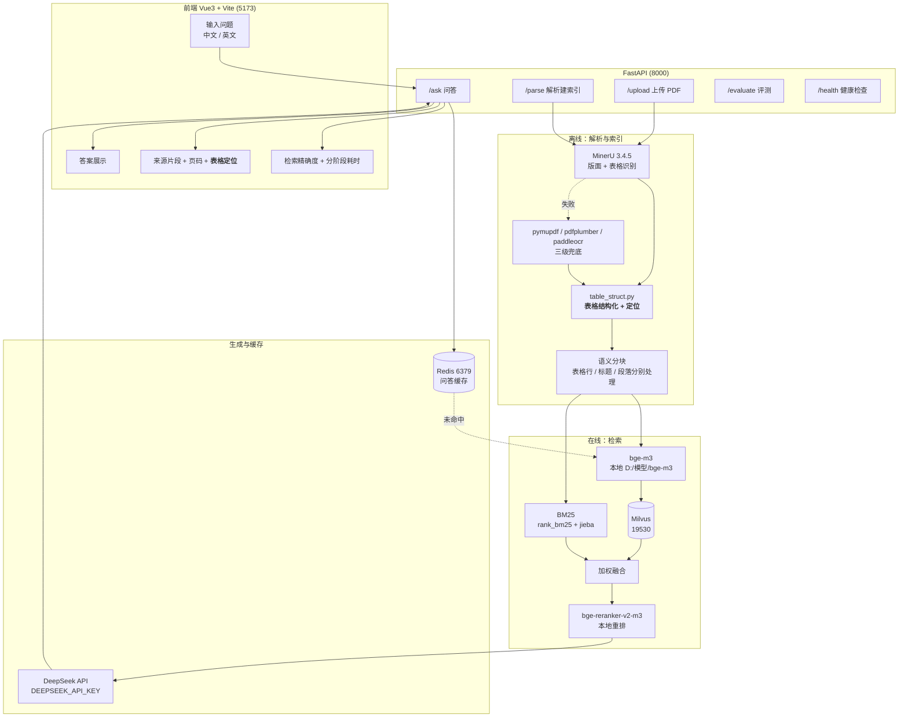

# 01 设计

**工单编号：人工智能NLP-RAG-PDF文档的表格解析及检索优化**
**对应工单**：《人工智能NLP-RAG项目-03-PDF文档的表格解析及检索优化任务工单V1.1-20250206》

---

## 1. 需求到设计的映射（先确认只做工单要求的事）

| 工单原文要求 | 出处 | 本设计对应 |
|---|---|---|
| 增加《招股说明书2.pdf》的解析 | P3 任务描述 | 多文档知识库：`data/raw/` 下两篇 PDF，块带 `doc` 字段 |
| 针对 14 个问题实现检索回复 | P3~P7 | `tests/test_questions.json` 14 题，逐题给答案 + 来源 + 精确度 |
| **分析答案在 pdf 中的定位，使用表格解析技术实现** | P8 备注 1 | `app/table_struct.py`：HTML 表格→单元格矩阵→表头识别→行块，输出**表格定位** |
| 准确率 ≥ 90% | P4、P7 | 关键字段全命中口径，逐题判定 |
| 响应 ≤ 3 秒 | P4、P7 | 并行召回 + 缓存 + 限制 top_k，测 p50/p95/max |
| 高可用、容错（输入错误、解析失败） | P4 | Milvus/Redis/LLM 三级降级，逐接口友好提示 |
| 支持中英文问答 | P7 | `lang` 参数 + 同语言作答 + 英文题纳入评测 |
| 代码注释含工单编号 | P8 备注 2 | 每个 `.py` 头部与每行代码注释均带工单编号 |

**不做**：登录/注册/权限/支付/后台、其他公司文档、其他问题、模型微调。（工单未提及）

---

## 2. 系统架构



---

## 3. 数据流（工单要求的链路，逐段标注产物与定位信息）

```
data/raw/招股说明书1.pdf  (兴图新科, 548 页)
data/raw/招股说明书2.pdf  (力源信息, 350 页)      ← 工单三新增
        │
        │ ① PDF 解析  ── MinerU pipeline 后端 (-t True 开启表格识别)
        │               失败 → pymupdf/pdfplumber → paddleocr
        ▼
data/parsed/<文档名>/auto/<文档名>_content_list.json
        │   每个块含: type / text 或 table_body(HTML) / table_caption / page_idx / bbox
        │
        │ ② 表格结构化 (table_struct.py)  ★工单三核心
        │   HTML → 单元格矩阵 (含 rowspan/colspan 展开) → 表头行识别
        │        → 每行生成一个"行块"，文本 = 章节名 | 表题 | 表头: 值
        │        → 附带定位元数据: table_id / row_index / locator
        ▼
        │ ③ 语义分块 (chunking)
        │   表格行块独立成块(不与段落混)；标题作章节语境；长段落按句切分、
        │   相邻单元向量相似度 < 阈值处切块；过短块合并
        ▼
        │ ④ bge-m3 向量化  (1024 维, L2 归一化, 内积=余弦)
        ▼
        │ ⑤ Milvus 存储   collection: gd3_chunks
        │   ┌────────────┬──────────────────────────────────────────┐
        │   │ 字段        │ 说明                                      │
        │   ├────────────┼──────────────────────────────────────────┤
        │   │ id          │ 自增主键 (auto_id)                        │
        │   │ vector      │ FLOAT_VECTOR(1024), 度量 IP               │
        │   │ doc         │ 文档名，如 "招股说明书2"                   │
        │   │ chunk_id    │ 全局唯一块号                               │
        │   │ text        │ 块文本（表格行块已带表头语境）              │
        │   │ page_no     │ 起始页（1 起，与 PDF 页码一致）            │
        │   │ page_end    │ 结束页                                    │
        │   │ block_type  │ title / text / table_row / table          │
        │   │ table_id    │ 表格定位：<doc>#p<页码>#t<该页表序>        │
        │   │ table_caption│ 表题，如"本次发行情况"                    │
        │   │ row_index   │ 行号（表内第几行，1 起）                   │
        │   │ locator     │ 人类可读定位串，前端直接展示                │
        │   └────────────┴──────────────────────────────────────────┘
        ▼
        │ ⑥ BM25 关键词检索   rank_bm25.BM25Okapi
        │   语料 = 全部块的 jieba 分词结果（英文/数字原样保留），索引落盘 data/bm25.pkl
        │   参数 k1=1.5, b=0.75（rank_bm25 默认）；对数字、比例、专有名词敏感
        ▼
        │ ⑦ 混合检索   向量 Top20 ∥ BM25 Top20（并行）→ 各自 min-max 归一化
        │              → 0.7×向量 + 0.3×BM25 加权融合 → 取 Top25 进重排
        ▼
        │ ⑧ bge-reranker-v2-m3 重排   (问题, 块) 成对打分 → 取 Top6
        ▼
        │ ⑨ DeepSeek 生成   temperature=0，强制同语言作答，资料无据则明确拒答
        ▼
        │ ⑩ Redis 缓存   key: gd3:ask:<md5(question|lang)>   TTL 24h
        ▼
    FastAPI 返回 { answer, contexts[{text,page_no,locator,table_caption,...}],
                   accuracy/精确度字段, retrieval_ms, generate_ms, elapsed, cached }
        ▼
    Vue 展示：答案 / 来源片段 / 页码 / 表格定位 / 检索精确度 / 耗时
```

---

## 4. 表格解析如何定位答案（工单 P8 备注 1 的正面回答）

14 题里 **6 题**的答案直接落在表格中，表格解析是这些题能否答对的唯一途径：

| 题号 | 答案 | 表格位置 |
|---|---|---|
| 1 | 1,670 万股，占发行后总股本 25.04% | 招股说明书2 P22「四、本次发行情况」表 / P24 发行基本情况表 |
| 2 | 仓储及物流中心 3,393.40、研发中心 1,526.38、电子商务平台 2,492.78、扩充产品种类和数量 9,000.00 等 | 招股说明书2 P22「五、募集资金用途」表 |
| 3 | 赵马克，42.35%，公司控股股东 | 招股说明书2 P157「1、存在控制关系的关联方」表 |
| 4 | 融冰投资、武汉博润、上海博润、听音投资、联众聚源、力源贸易、普芯达 | 招股说明书2 P157「2、不存在控制关系的关联方」表 |
| 207 | 补充流动资金 15,000.00 万元 | 招股说明书1 P479 募集资金投资项目表 |
| 531 / 543 | 法定代表人 程家明 / 注册资本 5,520.00 万元 | 招股说明书1 P22 发行人基本情况表 |

**定位方法（四步）**

1. **抽表**：MinerU 的表格只存在 `table_body` 字段（HTML），`text` 字段里没有。只取 `text` 会丢掉全部 502 张表，这是第一个必须绕开的坑。
2. **还原矩阵**：解析 `<tr>/<td>`，把 `rowspan`/`colspan` 展开成规整的二维单元格矩阵——不展开的话，"关联方名称/持股比例/与本公司关系" 三列表头与数据行会错位，答案串到别的列。
3. **识别表头**：取矩阵首行（或首个非空行）作为表头；把表头拼进**每一个数据行**的文本，行块形如
   `存在控制关系的关联方 | 关联方名称: 赵马克 | 持股比例: 42.35% | 与本公司关系: 公司控股股东`。
   这样一行就是一条自解释的事实，BM25 与向量检索都能直接命中"42.35% 持股比例"。
4. **写定位**：为每行记录 `page_no`（页码）、`table_id`（哪张表）、`row_index`（第几行）、`locator`（可读串，如 `招股说明书2 P157 表1 第2行`），随检索结果一路带到前端展示。

**水印噪声的处理**：招股说明书1 为带水印版本，MinerU 会把水印字符粘进单元格（实测 `项目名称gongzhin`、`m1武汉兴图新科…`）。
在结构化时按"小写拉丁字母串紧贴中文"的规则剔除（如 `gongzhin`、`m1`），保留 `C39`、`IC`、`P&S`、`A股` 等合法大写英文，避免误伤。

**为什么行块不并入段落块**：一行就是一条完整事实，若与相邻段落合并，向量会被稀释、BM25 词频被摊薄，`42.35%` 这类关键数字的排序会掉出前列。

---

## 5. 接口设计

| 方法 | 路径 | 入参 | 出参要点 | 容错 |
|---|---|---|---|---|
| POST | `/upload` | `file` (PDF) | 文件名、字节数、落盘路径 | 非 PDF / 超大 / 重名 → 400 带中文原因 |
| POST | `/parse` | `{doc?, use_mineru?}` | 每篇文档的解析器、块数、表格数、耗时 | 解析失败逐级降级；全失败返回 500 带原因 |
| POST | `/ask` | `{question, lang, use_cache?}` | `answer`、`contexts[]`（含 `locator`/`table_caption`/`row_index`）、`retrieval_ms`/`generate_ms`/`elapsed`、`cached` | 空/超长输入、Milvus 不可用、Redis 不可用、LLM 失败均有友好提示 |
| POST | `/evaluate` | `{mode?}` | 14 题准确率、检索精确度、耗时、Ragas 四项 | 缺密钥时明确提示，不抛栈 |
| GET | `/health` | — | api / milvus / redis / llm_key / 文档与索引状态 | 任一依赖异常仍返回 200，供前端告警 |

`lang` 取值：`zh`（默认）/ `en`；`auto` 时按问题中 CJK 字符占比自动判定。

---

## 6. Redis 键设计

| 键 | 类型 | 内容 | TTL | 用途 |
|---|---|---|---|---|
| `gd3:ask:<md5(question\|lang)>` | string(JSON) | 答案 + contexts + 分阶段耗时 | 24h | 相同问题直接命中，实测 0.00s |
| `gd3:hit` | hash | 各缓存键命中次数 | 无 | 热点问题观察（仅在日志/健康检查中读取，不参与业务逻辑） |

Redis 不可用时静默降级为"每次都走完整链路"，绝不阻断问答。

---

## 7. BM25 索引方案

- 库：`rank_bm25.BM25Okapi`（工单允许"rank_bm25 或同等库"）。
- 分词：`jieba.lcut` + 全小写；英文与数字不切碎，保证 `1,670`、`25.04%`、`42.35%` 这类串可精确命中。
- 语料：全部块的 `text`（含表格行块），跨两篇文档共用一个索引，靠 `doc` 字段区分。
- 持久化：`data/bm25.pkl`，服务启动载入一次常驻内存；重建索引时一并刷新。
- 召回：`BM25_TOP_K=20`，只保留得分 > 0 的块。

---

## 8. 检索精确度如何定义与展示（工单 P5 要求"显示检索到的答案及检索精确度"）

| 指标 | 定义 | 展示位置 |
|---|---|---|
| 逐题**片段相关度** | 重排模型对该片段的打分（0~1） | 前端每个来源片段右上角 |
| **检索精确度（上下文命中）** | 检索到的上下文中已含该题全部关键字段 | 前端结果区 + 评测报告 |
| **出处命中率** | 检索片段的页码/表格定位覆盖标准答案所在页 | 评测报告（表格题按 `table_id` 判定） |
| Ragas `context_precision` / `context_recall` | 判官模型打分 | 评测报告 |

---

## 9. 目录结构

```
工单三/
├── app/
│   ├── config.py          # 集中配置：从 .env 与环境变量读取
│   ├── pdf_parser.py      # MinerU 主解析 + pymupdf/pdfplumber/paddleocr 三级兜底
│   ├── table_struct.py    # ★ 表格结构化与定位（工单三核心）
│   ├── chunking.py        # 语义分块：表格行 / 标题 / 段落分别处理
│   ├── vector_store.py    # bge-m3 编码 + Milvus 读写
│   ├── retriever.py       # BM25 + 混合检索 + 融合 + bge-reranker-v2-m3 重排
│   ├── cache.py           # Redis 缓存封装
│   ├── rag_core.py        # 索引构建 + DeepSeek 生成 + 问答主流程与容错
│   ├── main.py            # FastAPI 五个接口
│   └── evaluate_ragas.py  # 14 题评测 + Ragas 四项
├── frontend/              # Vue3 + Vite 问答界面
├── data/raw/              # 两篇招股说明书 PDF
├── data/parsed/           # MinerU 解析产物（自动生成）
├── tests/test_questions.json  # 工单 14 题 + 标准答案 + 关键字段 + 出处
├── docs/                  # 01~05 与演示脚本
└── results/               # 评测结果落盘
```

---

## 10. 已知环境约束（写在前头，避免后面当成 bug 反复查）

| 约束 | 现象 | 本项目对策 |
|---|---|---|
| 中文用户名路径 | MinerU 依赖的 fasttext 打不开含中文的路径 | 子进程注入 `PYTHONPATH=C:/mineru_models/langfix` |
| `.env` 反斜杠 | `D:\模型\bge-m3` 的 `\b` 被当退格符 | 路径一律正斜杠，`.env.example` 顶部注明 |
| MinerU 与主程序环境不同 | MinerU 3.4.5 装在 Py3.12，主程序依赖装在 Py3.10 | 配置项 `MINERU_PYTHON` 指定解析器解释器，见 `config.py` 注释 |
| 本机端口 | Milvus 19530 / Redis 6379 已由既有容器占用 | 直接复用，不重复 `docker compose up` |
| GPU 8G | 两个重任务并行会被系统杀 | 解析与评测串行执行 |
